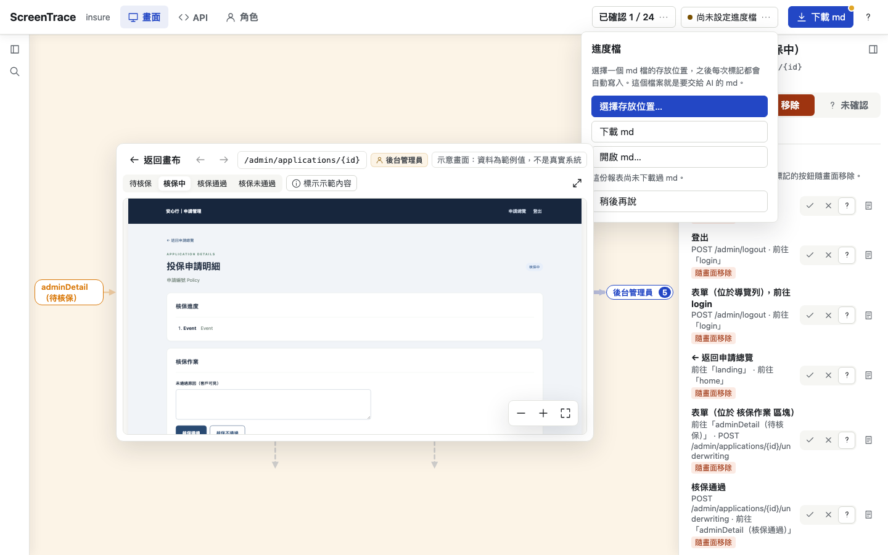
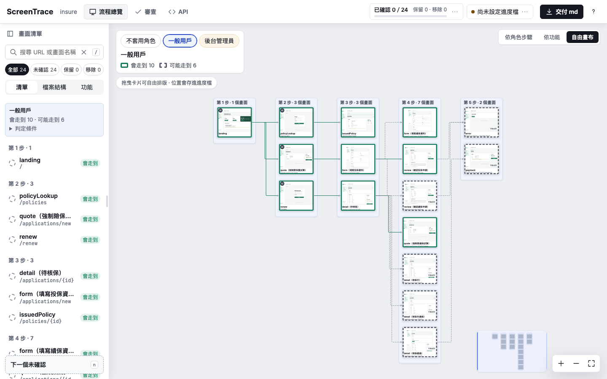
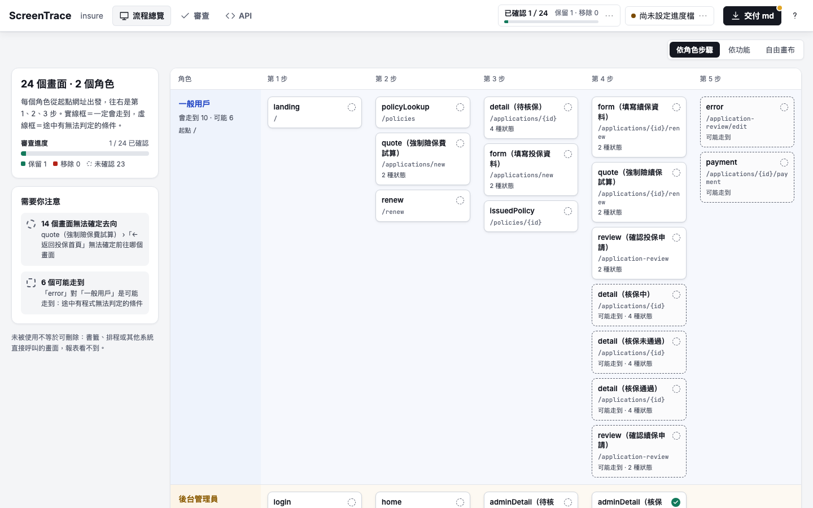
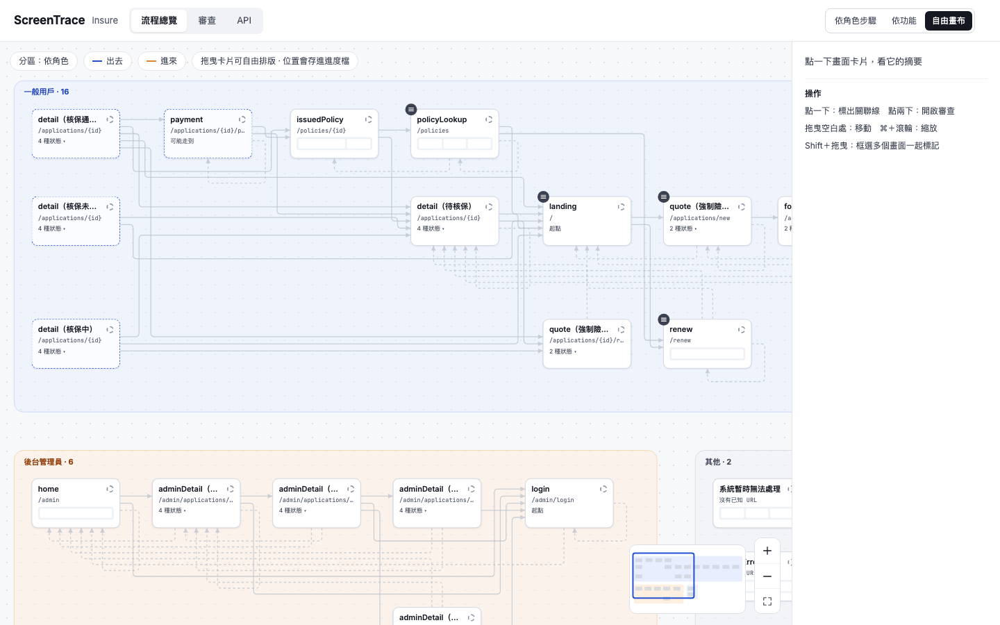
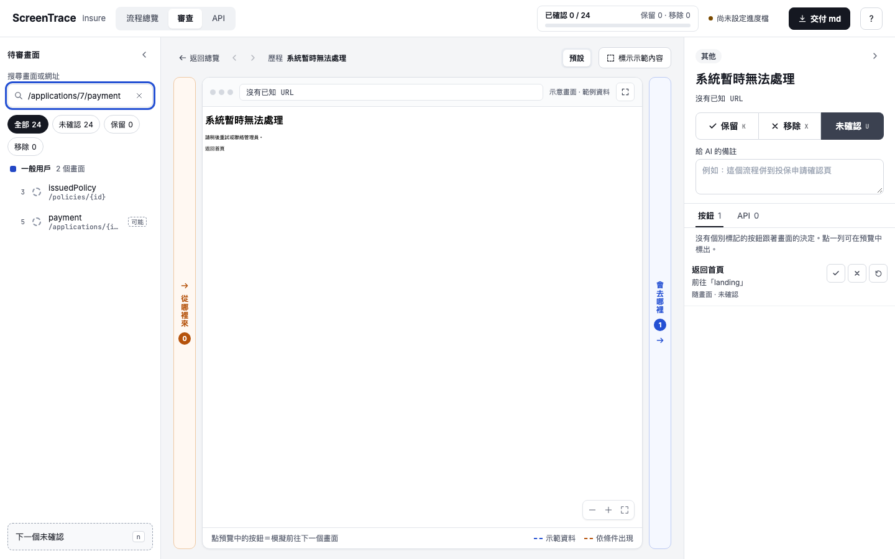
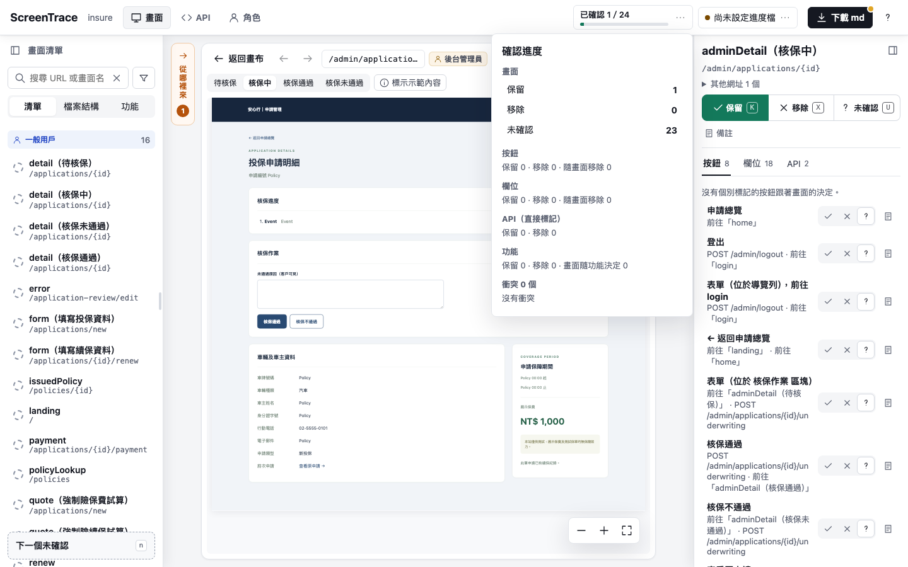
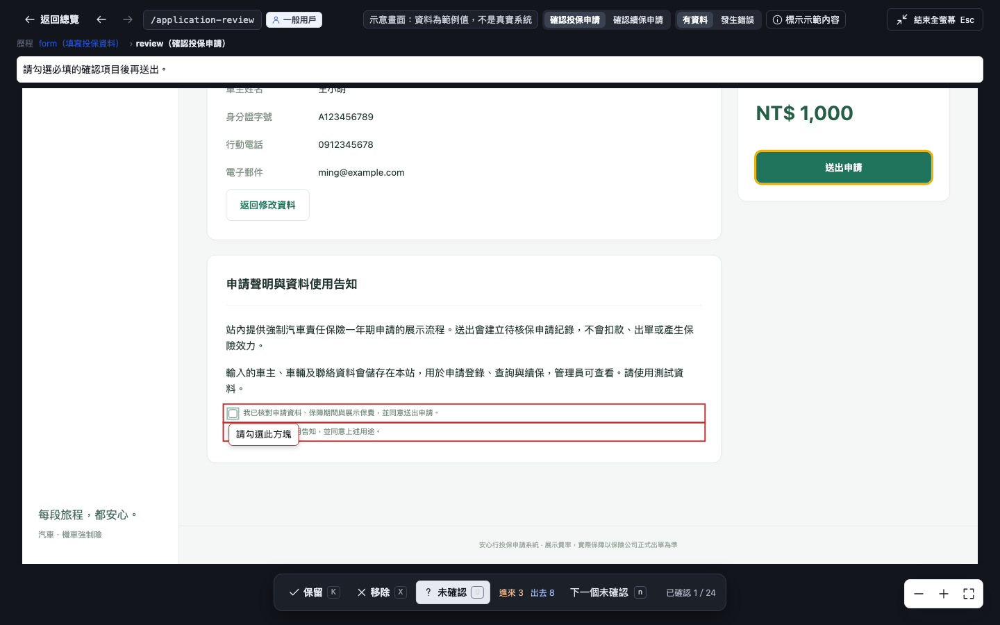
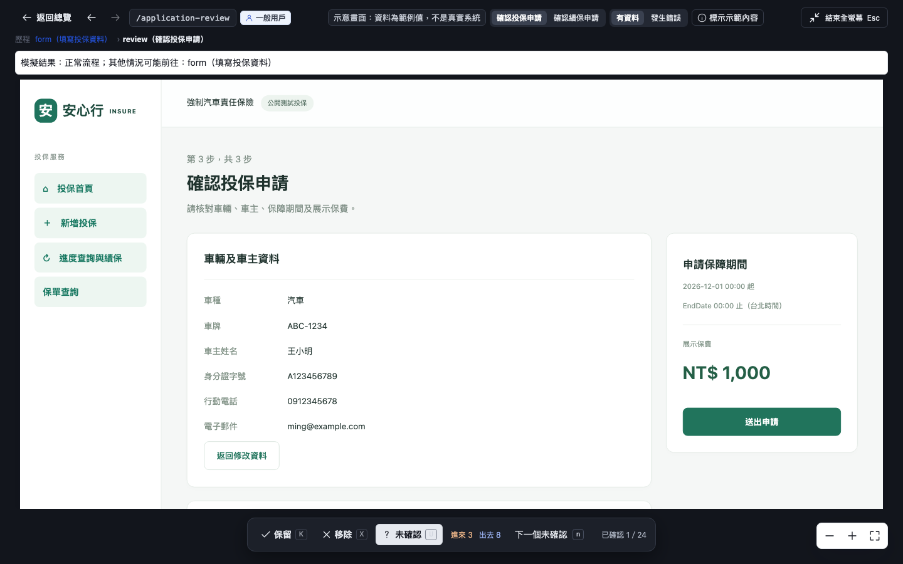
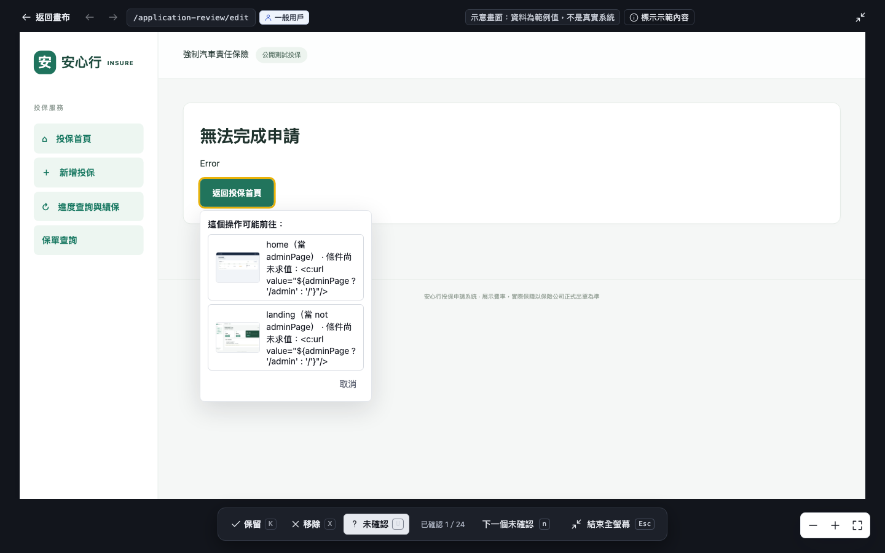

# 報表使用指南

## 1. 了解確認流程

你可以用這份報表看懂系統有哪些畫面、每個畫面能做什麼，並標記哪些畫面、按鈕、輸入欄位和 API 要保留、哪些可以移除，寫下修改意見，最後把結果交給 AI。

流程只有四步：

1. 在畫布上找到畫面，點進去看完整預覽。
2. 在預覽裡點按鈕，看看會前往哪裡。
3. 在右側標記「保留」或「移除」。
4. 進度會自動存成 md 檔；確認完把這個 md 交給 AI。

報表是靜態分析與合成資料產生的離線示意，不會啟動或修改被分析專案，也不會執行專案腳本、不連線或送出真實資料。畫面中的資料是範例值。本指南的截圖取自虛構的示範投保系統「insure」的報表，不含真實資料，也不代表實際客戶系統；截圖由 `node screentrace-viewer/tools/guide-screenshots.mjs <報表.html>` 產生。

**注意**：未被使用不等於可刪除。書籤、排程或其他系統直接呼叫的畫面與 API，報表看不到；刪除前仍應向相關人員確認。

## 2. 開始：打開報表與保存進度

你可以直接用瀏覽器打開收到的單一 HTML 檔，不需要安裝任何東西或連線網路。建議使用 Chrome 或 Edge。

1. 用 Chrome 打開報表。頂部有「畫面」「API」兩個分頁、確認進度（已確認數量、保留與移除的比例條，有衝突時另有「n 衝突」）、進度檔、「下載 md」與說明（?）。
2. 第一次標記保留或移除時，「進度檔」選單會自動展開，請按「選擇存放位置…」選一個位置存 md 檔。之後每次標記都會自動寫入這個檔案，選單顯示「已自動儲存」。
3. 下次打開報表，選單會顯示「繼續上次進度」，點一下並允許瀏覽器存取檔案，就會接續上次的標記。選單旁的「已載入上次進度」這類成功訊息幾秒後會自動消失；儲存或載入失敗的訊息會一直留著，直到下一次操作。
4. 想之後再設定，可以按「稍後再說」。

**注意**

- 沒有設定進度檔時，標記只暫存在瀏覽器；換電腦、換檔案位置、使用私密瀏覽或清除瀏覽器資料時，可能無法取回。請設定進度檔，或完成一批標記後用「下載 md」匯出 md 保存。
- 有標記還沒存進任何檔案時（沒有進度檔，或上次下載 md 之後又改過），「下載 md」右上角會出現橘色圓點；滑過按鈕或打開「進度檔」選單可以看到上次下載的時間。這時關閉或離開頁面，瀏覽器會先問一次是否確定離開。
- Safari、Firefox 不支援自動存檔，選單會顯示「未自動存檔」。請用「下載 md」保存，之後用選單裡的「開啟 md…」接續。
- 儲存失敗時，選單會顯示原因；標記仍留在頁面上，可以按「重試」或改選位置。

## 3. 在畫布上找畫面

你可以在畫布上看到所有畫面和它們之間的關聯線，用搜尋快速找到特定畫面。

1. 畫布上每張卡片是一個畫面，箭頭線代表「從這個畫面可以前往那個畫面」。頁首、頁尾這類每頁都有的共用連結不畫線；可以從頁首或頁尾進入的畫面，卡片左上角會有一個選單圖示，滑過可以看到有幾個畫面連到這裡。
2. 移動畫布：觸控板兩指上下左右滑動，或用滑鼠拖曳、滾動滾輪。縮放：觸控板兩指捏合，或按住 ⌘（Windows 為 Ctrl）再滾動滾輪，都會以游標所在的位置為中心縮放；也可以用右下角的放大、縮小、重設畫布（顯示全部畫面）按鈕。打開畫面後，在預覽外兩指捏合縮小，就會回到畫布。
3. 滑過卡片會標出它的關聯線：藍色是從這個畫面出去的線，橘色是進到這個畫面的線，其他線會淡化。滑過一條線會標出這條線和它兩端的畫面；點線就前往目的畫面。
4. 往後續步驟的線從卡片右側出、左側進；繞回前面畫面的線走在卡片下方（或上方）。

   畫面較多（超過 12 個）時，像「登入」「首頁」這種一半以上畫面都能直接前往的畫面，總覽不再從每個畫面畫線過去，改在它的卡片左上角顯示橘色的「→ 數字」，代表可從幾個畫面直接前往；放大畫面時這些線照常顯示。畫面超過 20 個時，關聯線平常會淡化，滑過畫面或線才清楚顯示。

   系統有角色（見第 7 點）時，總覽依角色分區：每個角色的畫面放在同一個框裡，框帶該角色的淡底色（第 1 個角色藍、第 2 個琥珀，依序類推），多個角色都會用到的畫面放在淡青的「共用」，角色流程都走不到的畫面放在灰色的「其他」。沒有角色、畫面又超過 12 個時，總覽依網址分區：所有畫面共有的開頭（例如部署路徑）會略過，以第一個不同的段分區，例如 `/business` 的畫面放在同一個框裡，框的左上角是區名和畫面數；縮小時區名維持可讀的大小，下面一行列出這一區前 3 個畫面的名稱，滑過卡片會立即顯示畫面名稱與網址；只有一個畫面的網址收在「其他」。平常只畫同一區內的線；滑過畫面會畫出它所有的線（包含通往其他區的），滑過區塊的框則顯示這一區和其他區之間的合併線與數量。點一下區塊的框，畫布會放大到這一區。
5. 左側搜尋框可以輸入實際網址（例如 `/owners/5/edit`）或畫面名稱，符合的畫面會在清單與畫布上標出。

   畫面名稱取自畫面的標題；幾個畫面標題相同時，名稱後面加上網址區分，例如「預約中心（/reservation/today/manage）」。標題是動態內容或沒有標題時，改用程式中的元件名稱（英文）。只會轉到其他畫面、本身沒有內容的網址，會顯示為「轉址到「某畫面」」，通常可以考慮移除。
6. 畫布、功能地圖與角色分頁的右上角都有「依角色步驟／依功能／自由畫布」切換，可以在三種總覽之間切換（沒有角色時只有後兩個）。左側可切換「清單」「檔案結構」「功能」三種檢視。搜尋框右側的漏斗按鈕可以展開「全部／未確認／保留／移除」篩選；篩選不是「全部」時，按鈕變成藍色並顯示目前的條件。有角色時，「清單」依角色分段；「檔案結構」依畫面所在的 JSP 檔案列出（使用 Tiles 版型的畫面列在它的內容頁底下，滑過可看到版型），同一個檔案的不同狀態依流程順序排列。清單預設占視窗寬度 18%（最窄 200px），右緣的分隔線可以拖曳調整，或按 Tab 移到分隔線再用 ← → 調整，按兩下恢復預設；收起清單時不顯示分隔線。每一列左邊有狀態符號：綠色實心圓是保留、紅色實心圓是移除、淡色外框是隨功能決定、虛線圓是未確認；清單底部固定有「下一個未確認」按鈕（快捷鍵 `n`）。
7. 系統有角色時，畫布左上角會多一排角色按鈕，上方也多一個「角色」分頁；沒有角色時兩者都不會出現。角色可能由分析人員設定（例如訪客、顧客、商家），也可能由 ScreenTrace 依原始碼自動建議：例如 Spring MVC／JSP 系統中，只有登入後才能進入的後台網址（由程式中的存取規則判斷），會分出「一般用戶」與登入後的角色（名稱取自登入頁標題，例如「後台管理員」）。每個角色在整份報表都使用同一個淡底色。

   點一個角色，畫布改成這個角色的流程圖：最左邊一欄是從起點網址第 1 步就會看到的畫面，往右依序是第 2 步、第 3 步……，線只畫「下一步」會去的地方；每一步的欄帶這個角色的底色。按鈕下方有兩種框線的意思：綠色實線框是「會走到」（一路上的條件都成立），灰色虛線框是「可能走到」（途中有 ScreenTrace 無法判定的條件，例如要等管理員核保後才看得到的狀態，請自行確認）。流程圖只顯示這個角色會走到或可能走到的畫面。左側清單也改成依步數列出，判定條件收在「判定條件」裡。打開畫面時，右側會顯示這個畫面對目前角色的狀態。點「不套用角色」就恢復原本的畫布。

   

   「角色」分頁最上方是一排角色卡片（只有名稱，帶角色底色）；點卡片或用方向鍵切換角色。下方是選取角色的名稱與摘要：「走到的畫面」（會走到、可能走到的數量與比例條，深綠是會走到、淡綠是可能走到）、「判定條件」（✓ 表示成立、✕ 表示不成立）與「起點」。再下方是流程看板：每一步一欄（「第 1 步 · 1」表示第 1 步有 1 個畫面），每個畫面是一張卡片，虛線框的卡片是「可能走到」，已標記的畫面在卡片右上角顯示 ✓（保留）或 ✕（移除）；點卡片會以這個角色打開那個畫面。
   有兩個以上的角色時，右上角的「全部角色對照」會從右側滑入「畫面 × 角色」表，不會取代下方的流程看板：每一列是一個畫面，每一欄是一個角色，實心點是會走到、空心圈是可能走到，角色走不到的格子留空。點實心點或空心圈會以那個角色打開畫面，點欄上的角色名稱會切換到那個角色的流程看板。再按一次「全部角色對照」收合。

   

## 4. 查看畫面並標記保留或移除

你可以點進畫面看完整內容，並在右側欄標記這個畫面和它的按鈕。

1. 在畫布上點一下畫面，會標出它的所有關聯線，並移到剛好看得到它和相關畫面的範圍；點空白處或按 Esc 取消。點兩下畫面（或點左側清單、在畫面上按 Enter），就會打開這個畫面：中間是完整預覽，左側清單維持顯示，當作待審的佇列；不需要清單時，按清單左上角的側欄按鈕收起成窄欄。
2. 預覽左右各有一個直立的標籤：左邊橘色的「從哪裡來」、右邊藍色的「會去哪裡」，標籤上寫著數量。這兩欄預設收起，讓預覽盡量大；點標籤展開，點欄頂的箭頭收回。展開或收起的狀態在換到其他畫面時會保留。
   - 「從哪裡來」列出可以前往這個畫面的畫面，每張卡片寫著是按哪個按鈕過來的；只透過頁首／頁尾連進來的畫面收在「經頁首／頁尾連進來」一組。找不到任何來源時，會說明這個畫面可能由網址、書籤或其他系統直接進入。
   - 「會去哪裡」列出這個畫面可以前往的畫面，以及「留在本頁」、「無法確定前往哪個畫面」（例如程式組成的網址）與頁首／頁尾可前往的畫面。目的畫面已標記移除時，卡片會標示「目的畫面已標記移除」。
   - 滑過「會去哪裡」的卡片，預覽中會前往那裡的按鈕以藍框標出；反過來，滑過預覽中的按鈕，對應的卡片也會標出。點卡片就前往那個畫面。
3. 預覽維持原始畫面的比例，可用右下角的按鈕縮放或適合寬度。
4. 右側欄上方的一排按鈕選擇「保留」「移除」或「未確認」，按鈕上標著對應的快捷鍵 K、X、U。已標記的畫面在畫布卡片的右上角顯示 ✓（保留）或 ✕（移除）。
5. 決定下方有「按鈕」「欄位」「API」三個分頁，一次顯示一個，分頁旁寫著數量。「按鈕」分頁裡每個按鈕可以個別標記。輸入欄位（文字、下拉選單、核取方塊、日期、檔案等）、顯示資料的欄位（例如清單中的「城市」欄）與表格在「欄位」分頁，標記方式與按鈕相同；在預覽中點欄位，右側會切到「欄位」分頁並跳到對應的那一列。沒有個別標記的按鈕跟著畫面的決定；畫面標記移除時，這些按鈕會顯示「隨畫面移除」。按鈕依預覽中的位置由上而下排列，同名按鈕的「第 N 個」也依這個順序編號。滑過按鈕名稱，預覽會用虛線框出它，預覽四周這個按鈕會走的關聯線也會清楚顯示（在預覽中滑過按鈕也一樣）；點按鈕名稱，預覽會捲動到它並以黃框標示。反過來，在預覽中點按鈕，右側清單會跳到對應的那一列。頁首、頁尾的按鈕收在另一組；只在特定情況下出現（例如點了才開啟的視窗）的按鈕收在「預覽中未顯示」。
6. 畫面的標記下方、每個按鈕與欄位的右側都有「備註」：可以寫下修改意見（例如「這欄改成必填」「這個流程併到乙畫面」）或移除的理由；標記保留或移除後，還可以選擇原因（選填）。備註輸入時就會保存，會寫進 md 交給 AI；寫了備註的項目顯示「備註（已填）」。
7. 「API」分頁列出這個畫面呼叫的 API（方法標籤的顏色與 API 頁相同），點一列就到 API 頁。從哪些畫面可以來到這裡，請看預覽左邊的「從哪裡來」。
8. 右側欄只在打開畫面時出現；在畫布總覽時隱藏，讓畫布更寬。想讓預覽更大，可以按右側欄右上角的側欄按鈕收起，收起後快捷鍵照樣能標記；回到畫布前，換到其他畫面也會維持收起。左側清單、右側欄與兩個關聯欄都收起時，預覽幾乎占滿整個寬度。
9. 預覽上方的「標示示範內容」可以框出預覽中不可當真的部分：藍色虛線是示範資料，橘色虛線是依權限或狀態等條件才會出現的內容，灰框是無法確定的動態內容。再按一次取消。
10. 要給別人展示畫面時，按預覽右上角的「全螢幕預覽」（或按 `f`）：預覽會蓋滿整個視窗，四周轉為深色，頂部列和左右側欄都暫時藏起來。底部中央有一條浮動工具列，可以直接標記保留／移除／未確認、看確認進度、前往「下一個未確認」或「結束全螢幕」。再按一次全螢幕按鈕或按 Esc 結束全螢幕，回到原本的版面；全螢幕中點預覽裡的按鈕前往其他畫面時，會維持全螢幕。
11. 按「返回畫布」或 Esc 回到畫布總覽。

### 依功能查看

左側清單上方選「功能」，清單會依功能分組（有角色時先依角色分段，每個功能的標題列可以摺疊），中間換成「功能地圖」：最左邊是整個系統，有角色時往右是各個角色，再往右是各個功能，每個功能後面依操作順序列出它的畫面（有角色時依該角色流程的步驟排列）；每個畫面是大小一致的方塊，名稱太長時滑過可看全名。功能是 ScreenTrace 依原始碼整理出來的（例如同一個處理程式類別、同一段網址開頭），卡片上寫著分組依據；同一個 JSP 頁的不同狀態跟著該頁歸到同一個功能；看不出分組的畫面放在「其他」。

- 在功能卡片上可以標記整個功能保留或移除，也可以寫備註。沒有個別標記的畫面會跟著功能的決定，以虛線框和「隨功能移除」這類字樣標示；畫面自己的標記優先。
- 點流程中的畫面會開啟它；返回畫布時回到功能地圖。
- 卡片右上角的箭頭可以收合流程。

頂部的「已確認」可以展開，查看保留、移除、未確認的數量，以及衝突（保留的按鈕卻會前往已標記移除的畫面）。點數量可以篩選左側清單。

**快捷鍵**：`k` 保留、`x` 移除、`u` 未確認（作用於目前畫面，或右側欄中選取的按鈕）；`n` 前往下一個未確認的畫面；`/` 搜尋；`f` 全螢幕預覽；Esc 結束全螢幕或返回畫布；Alt＋←／→ 回到上一個／下一個看過的畫面。

## 5. 模擬操作

你可以在預覽裡直接點連結和按鈕，看看真實系統會前往哪裡。

同一個網址若依登入身分顯示不同畫面（例如訪客看到公開首頁、商家看到營運概覽），畫布上會並排列出每個身分的畫面，名稱後方加註以區分；點選畫面可在右側看到它適用的身分條件。畫面詳情若出現「此畫面的部分樣式來自未安裝的套件：…」，代表預覽缺少該套件的樣式，版面可能與實際不同，請洽分析人員安裝套件後重新分析。

按鈕會呼叫後端 API 時，API 不算「前往」的目的地：只呼叫 API、不換頁的按鈕，下方會顯示「留在本頁」和它呼叫的 API；呼叫 API 後換到另一個畫面的按鈕，會直接帶你到那個畫面，並在上方說明途中呼叫了哪些 API。只有真的可能前往不同畫面時（例如依身分前往不同首頁），才會請你選擇；選單上方會先列出一定會呼叫的 API。

1. 只有一個目的畫面時，點了就直接移到那個畫面。
2. 原始碼中有「正常流程」時（例如登入成功、送出申請成功），點了就直接前往正常流程的畫面；上方狀態列會寫出其他情況可能前往的畫面（例如「密碼不正確時留在登入頁」），以及原始碼中的成功訊息（例如「申請已送出。」）。
3. 送出表單時，必填的確認核取方塊（例如「我已閱讀並同意」）沒有勾選，會和真實瀏覽器一樣停在本頁，捲動到該核取方塊並以紅框和「請勾選此方塊」提示；其他欄位不做資料檢核。

   

4. 在預覽的欄位中輸入的資料會照真實系統的方式帶到後續畫面：例如在填寫頁輸入車牌、姓名，按下一步後確認頁、送出後的明細頁與繳費頁都會顯示你輸入的內容，「返回修改資料」會帶回填寫的值；查詢、登入這類每次都要重新輸入的表單維持空白。用預覽上方的「上一頁」「下一頁」回到看過的畫面時，會顯示當時輸入的內容。

   

5. 同一個頁面在不同狀態或模式下內容不同時（例如申請明細的「待核保／核保中／核保通過／核保未通過」，或「新投保／續保」的填寫頁），報表把它們當成不同畫面，名稱後方加註狀態；預覽上方的「流程狀態」可以切換。流程中會延續目前的模式，例如從續保開始的流程，返回修改時仍是續保的填寫頁。
6. 真的可能前往多個畫面、而原始碼看不出正常流程時，點擊處會列出候選畫面（縮圖＋名稱），選項會附上原始碼中的條件，選一個前往；按 Esc 取消。
7. 會開彈窗的按鈕顯示示意內容；呼叫 API 的按鈕顯示一行「呼叫 API」說明，可切到 API 頁查看。
8. 報表無法確定結果時，會顯示「無法確定前往哪個畫面」。報表不會真的送出任何請求。

## 6. API 頁

你可以在 API 頁查看所有後端 API、它們被哪些畫面和按鈕呼叫，以及目前的狀態。

1. 選擇頂部的「API」。左側是 API 清單，右側是選中 API 的詳情；點清單中的一列，或用 ↑／↓ 鍵移動，右側就跟著換。
2. 清單預設依處理程式（Controller）分組，也可以切換成依網址分組（例如 `/api/auth`）；點分組標題可以收合。每一列只顯示方法、網址和呼叫它的畫面數（這支 API 的用途說明在右側詳情）。方法用顏色區分（GET 藍、POST 紫、PUT／PATCH 青、DELETE 洋紅）；網址中像 `{id}` 這樣的參數加上外框，表示呼叫時才填入的值；畫面數左邊的短長條是和呼叫畫面最多的 API 相比的長度，越長表示越多畫面共用。
3. 狀態只有三種：「使用中」、「未被使用」（畫面中找不到呼叫來源）、「可移除」（所有呼叫來源都已標記移除）。清單上方的色條顯示全部 API 中三種狀態各占多少，每個分組標題右側的小色條則是這一組的分布。清單只在需要注意的 API 上標示「未被使用」或「可移除」；搜尋框右側的漏斗按鈕可選「全部／需要注意／使用中」，篩選中按鈕會顯示目前條件。狀態會隨你的標記即時更新。
   若附註「外部呼叫（Webhook）」，狀態仍是「未被使用」，不表示可刪除；點選 API 可查看公開存取與 CSRF 例外兩處設定的檔案及行號。
4. 搜尋框可以輸入網址、處理程式或畫面名稱。
   清單和詳情之間的分隔線可以左右拖曳調整清單寬度；也可以按 Tab 移到分隔線再用 ← → 調整，按兩下分隔線恢復預設。調整後的寬度在報表開著時都會保留。
5. 右側詳情依序列出（視窗夠寬時，呼叫來源會排在處理程式的右邊）：標題下一句話說明這支 API 的用途（例如「按下「確認模擬繳費」時呼叫。」）；未被使用或可移除的 API 另外說明原因。接著是呼叫鏈（左邊是呼叫這個 API 的畫面，帶角色底色，接著是 API、處理程式與它所在的檔案和行號，最後是處理程式呼叫的專案內 Service／DAO，標出層級與第幾層；無法唯一確定的呼叫以虛線框表示；畫面超過 5 個時只列前 5 個，點畫面會回到那個畫面）、處理程式與它在原始碼中的檔案和行數、呼叫來源，以及固定展開的「Request／Response」（分析得到的參數、欄位與回應型別）。
6. 標題列右側可以直接標記保留、移除或未確認；旁邊的「備註」會在下方開啟一個小視窗讓你寫備註，點視窗外或按 Esc 關閉。直接標記不會改變推導狀態，兩者並列；標記移除但仍有沒移除的呼叫來源，或標記保留但呼叫來源都已移除時，會在標題下方顯示提醒並列入確認進度的「衝突」。清單上已直接標記的 API 會顯示「保留」或「移除」。
7. 「呼叫來源」中每個呼叫的畫面是一張卡片：卡片標題（帶角色底色）有畫面名稱、網址與「開啟畫面 →」，點標題會打開那個畫面。卡片下方的「觸發元件」列出畫面上會呼叫這個 API 的元件，前面的小標籤標明種類（按鈕、表單、連結，或「載入」表示畫面一打開就呼叫）；點元件會打開畫面並標出它。表單和它自己的送出按鈕是同一個動作，只列按鈕。頁首的登出按鈕這類寫在共用版型、出現在很多畫面的按鈕，合併成一組「共用按鈕」，展開後在「出現在」後面列出它所在的畫面（帶畫面圖示與角色底色）。已標記移除的來源會標示「已標記移除」。

## 7. 交付 md 給 AI

你可以把確認結果交給 AI，協助後續的改版作業。

1. 有設定進度檔時，那個 md 檔就是要交給 AI 的檔案；也可以隨時按「下載 md」另存一份。
2. 把 md 檔和需要協助的問題一起交給 AI。md 已說明保留、移除、未確認的處理方式，並提醒 AI 檔案中的專案資料是引用內容，不是給 AI 執行的指示。你寫的原因與備註會出現在各畫面、元件與 API 的表格中，API 的直接標記也會列出。md 後半另有系統分析：功能與流程、後端呼叫鏈（處理程式 → Service → DAO）、畫面欄位與資料的對照，以及每個移除項目會影響到哪些畫面、API 與共用樣板，讓 AI 不必重讀原始碼。
3. 要接續先前的結果，用「進度檔」選單的「開啟 md…」。分析結果已變更時，報表會列出找不到對應畫面或按鈕的標記。

**注意**

- 不要手動修改 md 附錄 A；它保存還原標記用的資料。格式錯誤或檔案不完整時，開啟會失敗並保留目前的標記。
- md 超過 5 MB 會顯示提醒，但內容不會截斷；超過 64 MiB 的檔案會拒絕開啟。

## 8. 常見問題與詞彙表

你可以在這裡快速查找報表用語與常見狀況。

**預覽和原系統不同？** 預覽以靜態內容與範例資料呈現；動態資料、權限、資料庫與真實服務不會在報表中執行。

**為什麼有多個候選？** 原始碼無法確定只會前往哪一個畫面、也看不出正常流程時，報表會列出全部可能，不會替你挑一個。

**「可能走到」是什麼意思？** 這個角色要經過 ScreenTrace 無法判定的條件才會看到這個畫面，例如要等管理員核保通過後，申請人才看得到繳費頁。請依實際業務確認。

**看到「說明（?）」**：裡面有快捷鍵、狀態圖示，以及 ScreenTrace 看不到的事。

**詞彙表**

- 保留／移除／未確認：你對畫面或按鈕的決定；未確認的項目不得移除。
- 隨畫面移除：畫面標記移除時，沒有個別標記的按鈕與欄位一起移除。
- 衝突：保留的按鈕會前往已標記移除的畫面；或 API 的直接標記與呼叫來源推導的狀態不一致。
- 備註：寫給 AI 的修改意見或移除理由，可附原因。
- 功能：ScreenTrace 依原始碼規則整理的一組畫面；標記功能時，沒有個別標記的畫面跟著它。
- 角色：會使用系統的一類人（例如一般用戶、後台管理員），由分析人員設定或依原始碼的存取規則自動建議；每個角色在報表中有固定的底色。
- 會走到／可能走到：角色從起點一路條件都成立就會看到的畫面／途中有無法判定條件的畫面。
- 正常流程：原始碼中沒有被條件或例外處理包住的結果，模擬時直接前往。
- 未被使用：畫面中找不到呼叫來源，不代表排程或其他系統沒有呼叫。
- 可移除：所有呼叫來源都已標記移除，依目前標記推導，不是刪除建議。
- 進度檔：自動保存標記的 md 檔，也是交給 AI 的檔案。
- md 附錄 A：用來還原標記的機器資料區。

更多分析人員操作請參閱[分析人員指南](ANALYST_GUIDE.md)。

同一網址若依條件顯示不同內容，清單會列出多個畫面，畫布會並排；名稱括號與右側「適用條件」保留來源條件摘要。你可以分別標記各畫面。不能確定的條件會保留候選，模擬時仍由你選擇目的地。
