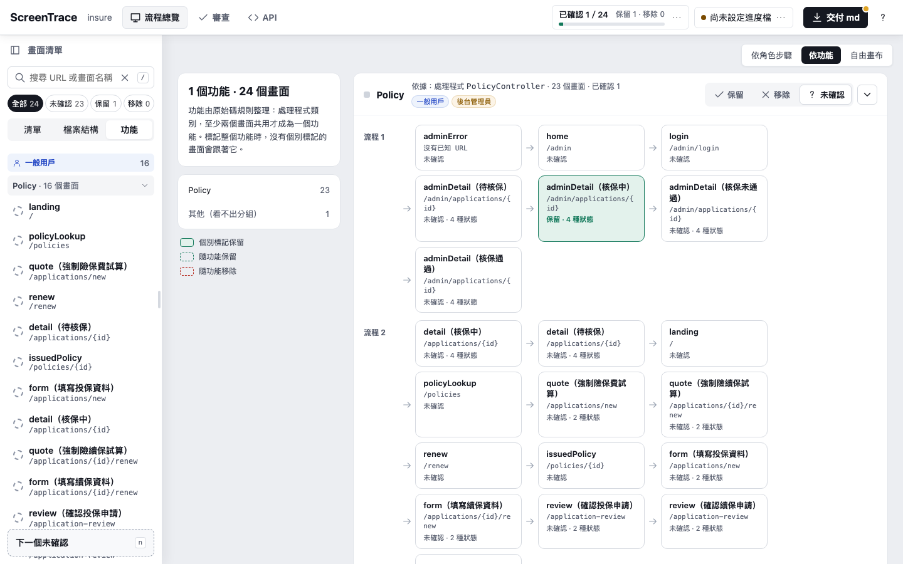
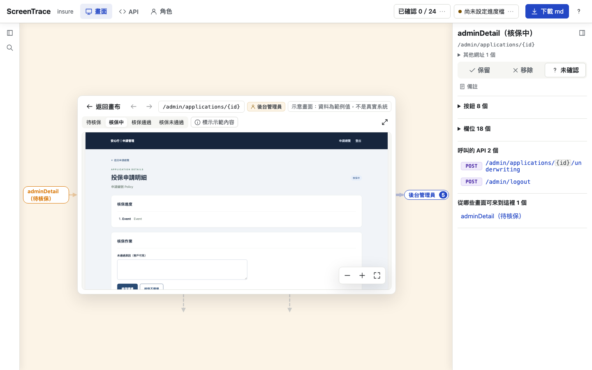
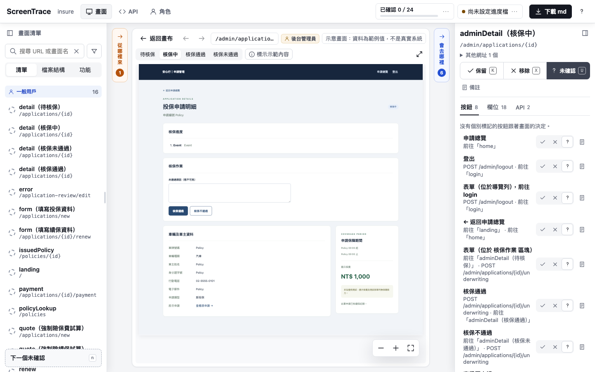
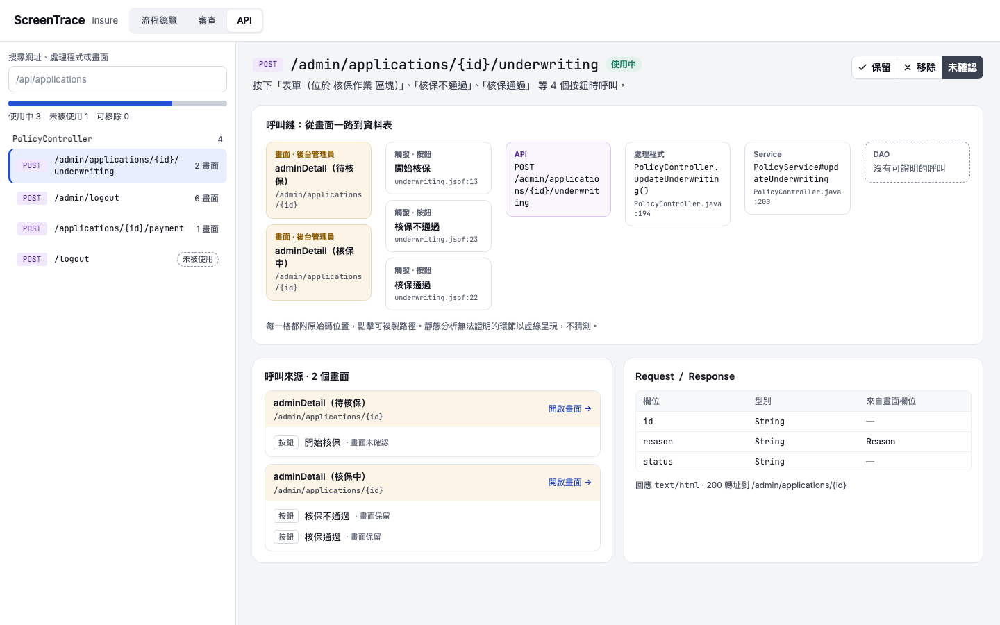
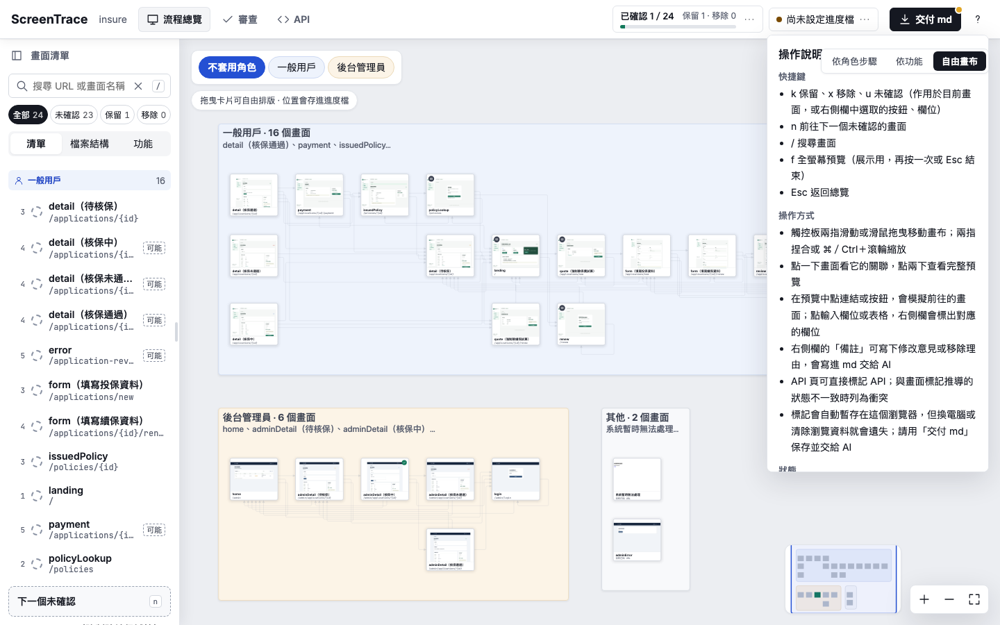

# 報表使用指南

## 1. 了解確認流程

你可以用這份報表看懂系統有哪些畫面、每個畫面能做什麼，並標記哪些畫面、按鈕、輸入欄位和 API 要保留、哪些可以移除，寫下修改意見，最後把結果交給 AI。

流程只有四步：

1. 在「流程總覽」找到畫面，點兩下打開；或按頂部的「審查」，從未確認的畫面開始。
2. 在預覽裡點按鈕，看看會前往哪裡。
3. 在右側標記「保留」或「移除」，需要時寫下給 AI 的備註。
4. 進度會自動存成 md 檔；確認完把這個 md 交給 AI。

報表是靜態分析與合成資料產生的離線示意，不會啟動或修改被分析專案，也不會執行專案腳本、不連線或送出真實資料。畫面中的資料是範例值。本指南的截圖取自虛構的示範投保系統「insure」的報表，不含真實資料，也不代表實際客戶系統；截圖由 `node screentrace-viewer/tools/guide-screenshots.mjs <報表.html>` 產生。

**注意**：未被使用不等於可刪除。書籤、排程或其他系統直接呼叫的畫面與 API，報表看不到；刪除前仍應向相關人員確認。

## 2. 開始：打開報表與保存進度

你可以直接用瀏覽器打開收到的單一 HTML 檔，不需要安裝任何東西或連線網路。建議使用 Chrome 或 Edge。

1. 用 Chrome 打開報表。頂部左邊有「流程總覽」「審查」「API」三個分頁：「流程總覽」看全部畫面與它們的關係，頂部右邊可切換「依角色步驟／依功能／自由畫布」；「審查」打開上次看的畫面（第一次按時打開下一個未確認的畫面）；「API」是 API 頁。
2. 在審查頁（打開畫面時），頂部右邊改成確認進度（「已確認 n / 總數」、「保留 n · 移除 n」與比例條，有衝突時另有「n 衝突」）、進度檔狀態（圓點、狀態與檔名）、「交付 md」與說明（?）。
3. 第一次標記保留或移除時，「進度檔」選單會自動展開，請按「選擇存放位置…」選一個位置存 md 檔。之後每次標記都會自動寫入這個檔案，進度檔狀態顯示「已自動儲存」和檔名。點進度檔狀態可以再打開這個選單。
   想讓每份報表的進度檔都存在同一個地方，可以按「設定預設資料夾…」選一個資料夾：之後的報表會直接在這個資料夾建立 `screentrace-review-<專案>.md`，不用再選位置（瀏覽器仍可能請你允許存取資料夾一次）。資料夾裡已有同名 md 時，會當作上次進度載入。
4. 下次打開報表，進度檔狀態會顯示「繼續上次進度」；打開選單點一下並允許瀏覽器存取檔案，就會接續上次的標記。「已載入上次進度」這類成功訊息幾秒後會自動消失；儲存或載入失敗的訊息會一直留著，直到下一次操作。
5. 想之後再設定，可以按「稍後再說」。

**注意**

- 沒有設定進度檔時，標記只暫存在瀏覽器；換電腦、換檔案位置、使用私密瀏覽或清除瀏覽器資料時，可能無法取回。請設定進度檔，或完成一批標記後在審查頁按「交付 md」保存。
- 有標記還沒存進任何檔案時（沒有進度檔，或上次交付 md 之後又改過），「交付 md」右上角會出現橘色圓點；滑過按鈕或打開「進度檔」選單可以看到上次交付 md 的時間。這時關閉或離開頁面，瀏覽器會先問一次是否確定離開。
- Safari、Firefox 不支援自動存檔，進度檔狀態會顯示「未自動存檔」。請用「交付 md」保存，之後用選單裡的「開啟 md…」接續。
- 儲存失敗時，選單會顯示原因；標記仍留在頁面上，可以按「重試」或改選位置。

## 3. 在畫布上找畫面

你可以在「流程總覽」看到所有畫面和它們之間的關聯。總覽有三種版面，用頂部右邊的「依角色步驟／依功能／自由畫布」切換（沒有角色時只有後兩個）；總覽不顯示左側清單。

1. 「自由畫布」上每張卡片是一個畫面：名稱、右上角的狀態圓點（綠色保留、紅色移除、虛線圓未確認）、網址，以及「N 種狀態」「可能走到」或「起點」。滑過卡片會顯示這個畫面的截圖、名稱與網址。箭頭線代表「從這個畫面可以前往那個畫面」。頁首、頁尾這類每頁都有的共用連結不畫線；可以從頁首或頁尾進入的畫面，卡片左上角會有一個選單圖示，滑過可以看到有幾個畫面連到這裡。左上角的小標籤寫出分區方式（例如「分區：依角色」）、出去與進來的線色，以及「拖曳卡片可自由排版」。
2. 移動畫布：觸控板兩指上下左右滑動，或用滑鼠拖曳空白處、滾動滾輪。縮放：觸控板兩指捏合，或按住 ⌘（Windows 為 Ctrl）再滾動滾輪，都會以游標所在的位置為中心縮放；也可以用右下角直立的放大、縮小、重設畫布（顯示全部畫面）按鈕。
3. 滑過卡片會標出它的關聯線：藍色是從這個畫面出去的線，橘色是進到這個畫面的線，其他線會淡化。滑過一條線會標出這條線和它兩端的畫面；點線就前往目的畫面。

   **自由畫布的其他操作**：
   - 畫布右側固定有選取畫面的面板。還沒選取時顯示操作提示；點一下卡片會標出它的關聯線、移到看得到相關畫面的範圍，面板顯示這個畫面的摘要：名稱、網址、所屬角色、進來與出去的數量、衝突提醒，以及「開啟審查 →」。點空白處取消。
   - 右下角的縮圖導覽畫出整張畫布與目前看到的範圍，點或拖曳縮圖就能移到那裡。
   - 按住 Shift 拖曳空白處會畫出選取框，框到的畫面都會被選取；Shift＋點卡片可以加入或移出選取。選了兩個以上時，右側列出這些畫面，可以一次「全部保留」「全部移除」或「全部設為未確認」。按 Esc 或「取消選取」結束。
   - 拖曳卡片可以自由排版，關聯線與區塊的框會跟著移動。排好的位置依版面（依角色分區、依網址分區）分開保存，會寫進進度檔與交付的 md（只在附錄 A，不影響給 AI 看的內容）；移動過卡片後，右下角會出現「重設排版」，按了回到原本的排列。移動過的卡片，關聯線改用簡單的直角線，可能穿過其他卡片。
4. 往後續步驟的線從卡片右側出、左側進；繞回前面畫面的線走在卡片下方（或上方）。

   畫面較多（超過 12 個）時，像「登入」「首頁」這種一半以上畫面都能直接前往的畫面，總覽不再從每個畫面畫線過去，改在它的卡片左上角顯示橘色的「→ 數字」，代表可從幾個畫面直接前往。畫面超過 20 個時，關聯線平常會淡化，滑過畫面或線才清楚顯示。

   系統有角色（見第 6 點）時，總覽依角色分區：每個角色的畫面放在同一個框裡，框帶該角色的淡底色（第 1 個角色藍、第 2 個琥珀，依序類推），多個角色都會用到的畫面放在淡青的「共用」，角色流程都走不到的畫面放在灰色的「其他」。沒有角色、畫面又超過 12 個時，總覽依網址分區：所有畫面共有的開頭（例如部署路徑）會略過，以第一個不同的段分區，例如 `/business` 的畫面放在同一個框裡；只有一個畫面的網址收在「其他」。框的左上角是區名和畫面數。平常只畫同一區內的線；滑過畫面會畫出它所有的線（包含通往其他區的），滑過區塊的框則顯示這一區和其他區之間的合併線與數量。點一下區塊的框，畫布會放大到這一區。
5. 要用網址（例如 `/owners/5/edit`）或名稱找畫面，請到審查頁左側「待審畫面」的搜尋框（快捷鍵 `/`，在總覽按也會打開審查頁）；搜尋與狀態篩選只作用在這份清單，不會篩選總覽。

   畫面名稱取自畫面的標題；幾個畫面標題相同時，名稱後面加上網址區分，例如「預約中心（/reservation/today/manage）」。標題是動態內容或沒有標題時，改用程式中的元件名稱（英文）。只會轉到其他畫面、本身沒有內容的網址，會顯示為「轉址到「某畫面」」，通常可以考慮移除。
6. 系統有角色時，總覽才有「依角色步驟」。角色可能由分析人員設定（例如訪客、顧客、商家），也可能由 ScreenTrace 依原始碼自動建議：例如 Spring MVC／JSP 系統中，只有登入後才能進入的後台網址（由程式中的存取規則判斷），會分出「一般用戶」與登入後的角色（名稱取自登入頁標題，例如「後台管理員」）。每個角色在整份報表都使用同一個淡底色。

   「依角色步驟」把所有角色排在同一張表：每一列是一個角色（帶角色底色，寫著會走到與可能走到的數量和起點），每一欄是第 1 步、第 2 步……，格子裡是這個角色在這一步會看到的畫面。實線框是「會走到」（一路上的條件都成立），虛線框是「可能走到」（途中有 ScreenTrace 無法判定的條件，例如要等管理員核保後才看得到的狀態，請自行確認）。卡片上有狀態符號（綠色 ✓ 保留、紅色 ✕ 移除、虛線圓未確認），同一頁有多種狀態時寫出「n 種狀態」，標記移除的畫面名稱加刪除線。點卡片會以這個角色打開那個畫面：「待審畫面」改成依這個角色的步數列出，每列標出「會走到」或「可能走到」，判定條件收在「判定條件」裡；右側欄也會顯示這個畫面對這個角色的狀態。點表格左欄的角色名稱，表格下方會展開這個角色走到的畫面比例、判定條件與起點，再點一次或按「收合」收起。
   表格左邊是摘要與審查進度，以及「需要你注意」：衝突、無法確定去向的畫面、只是「可能走到」的畫面，點一項就打開那個畫面。表格下方有「跨角色的交接點」，只列原始碼可以證明的兩種情況：一個角色的畫面有連結或表單直接前往另一個角色流程中的畫面，或兩個角色看到的是同一頁的不同狀態，每一條都寫出依據；旁邊是「任何角色都走不到」的畫面。

   

## 4. 查看畫面並標記保留或移除

你可以在審查頁看畫面的完整內容，並在右側欄標記這個畫面和它的按鈕。

1. 打開畫面的方法：在自由畫布點兩下卡片（或在卡片上按 Enter、按右側摘要的「開啟審查 →」），在「依角色步驟」「依功能」點畫面，或按頂部的「審查」。審查頁左側是「待審畫面」，中間是預覽，右側是標記用的側欄。
2. 「待審畫面」上方是「搜尋畫面或網址」搜尋框（`/`），下方是「全部／未確認／保留／移除」篩選，各自附數量，點一下就只列出那些畫面。有角色時，畫面依角色分組，每一列左邊標出步數，可能走到的畫面右邊標「可能」，有衝突的畫面另有警示符號。狀態符號：綠色實心圓是保留、紅色實心圓是移除、淡色外框是隨功能決定、虛線圓是未確認。清單底部固定有「下一個未確認」按鈕（`n`）。清單右緣的分隔線可以拖曳調整寬度（或按 Tab 移到分隔線再用 ← → 調整，按兩下恢復預設）；按清單右上角的按鈕可收成窄欄，窄欄顯示未確認的數量、搜尋與「下一個未確認」。
3. 預覽上方一排是「返回總覽」、上一個／下一個看過的畫面（← →）、「歷程」（最近看過的 3 個畫面，點一個就回到那裡）、「流程狀態」切換（只有一種狀態時顯示「預設」）與「標示示範內容」。
4. 預覽放在像瀏覽器的框裡：上方列顯示網址與「示意畫面 · 範例資料」，右端是全螢幕按鈕。預覽預設符合框的寬度；右下角的小按鈕可以縮小、放大或回到適合寬度。框的底部寫著「點預覽中的按鈕＝模擬前往下一個畫面」，旁邊是圖例：藍色虛線是示範資料，橘色虛線是依條件出現的內容。
5. 預覽左右各有一條直立的欄：左邊橘色的「從哪裡來」、右邊藍色的「會去哪裡」，寫著數量。這兩欄預設收起，讓預覽盡量大；點欄展開，點欄頂的「收起」收回。展開或收起的狀態在換到其他畫面時會保留。
   - 「從哪裡來」列出可以前往這個畫面的畫面，每張卡片寫著是按哪個按鈕過來的；只透過頁首／頁尾連進來的畫面收在「經頁首／頁尾連進來」一組。找不到任何來源時，顯示「起點畫面：直接以網址進入」，表示這個畫面可能由網址、書籤或其他系統直接進入。
   - 「會去哪裡」列出這個畫面可以前往的畫面（途中會呼叫 API 時寫出「經」哪支 API），以及「留在本頁」、「無法確定去向」（例如程式組成的網址）與頁首／頁尾可前往的畫面。目的畫面已標記移除時，卡片會標示「目的畫面已標記移除」。
   - 滑過「會去哪裡」的卡片，預覽中會前往那裡的按鈕會被標出；反過來，滑過預覽中的按鈕，對應的卡片也會標出。點卡片就前往那個畫面。
6. 右側欄最上方是畫面所屬的角色與它在角色流程中的第幾步，接著是畫面名稱與網址（有多個網址時可展開「其他網址」）。下面一整排「保留」「移除」「未確認」按鈕，標著對應的快捷鍵 K、X、U。已標記的畫面，總覽卡片上的狀態圓點會變成綠色（保留）或紅色（移除）。
7. 決定下方一直有「給 AI 的備註」文字框：可以寫下修改意見（例如「這個流程併到乙畫面」）或移除的理由；標記保留或移除後，還可以選擇原因（選填）。備註輸入時就會保存，會寫進 md 交給 AI。
8. 再下面是「按鈕」「欄位」「API」三個分頁，一次顯示一個，分頁旁寫著數量。
   - 「按鈕」：每一列寫出按鈕名稱、它的效果（例如「POST /admin/logout → 前往「login」」），以及目前的狀態（例如「隨畫面 · 未確認」「隨畫面移除」「個別標記：保留」）。右邊的 ✓ 是保留、✕ 是移除、↺ 是跟隨畫面的決定（也就是未確認）；沒有個別標記的按鈕跟著畫面的決定。按鈕依預覽中的位置由上而下排列，同名按鈕的「第 N 個」也依這個順序編號；頁首、頁尾的按鈕收在另一組，只在特定情況下出現（例如點了才開啟的視窗）的按鈕收在「預覽中未顯示」。
   - 「欄位」：列出輸入欄位（文字、下拉選單、核取方塊、日期、檔案等）、顯示資料的欄位與表格，只供查看：每一列顯示「隨畫面」，或從開啟的 md 帶進來的個別標記。欄位不能在報表中個別標記；舊 md 裡欄位的標記與備註會保留，並照樣寫進交付的 md。在預覽中點欄位，右側會切到「欄位」分頁並跳到對應的那一列。
   - 「API」：列出這個畫面呼叫的 API（方法標籤、網址，以及「由「某按鈕」觸發」或「畫面載入時呼叫」），點一列就到 API 頁。
9. 滑過按鈕或欄位的列，預覽會用黃色虛線框出它，「會去哪裡」的對應卡片也會標出（在預覽中滑過按鈕也一樣）；點列的名稱，預覽會捲動到它並以黃框標示。反過來，在預覽中點按鈕，右側清單會跳到對應的那一列。
10. 「標示示範內容」會框出預覽中不可當真的部分：藍色虛線是示範資料，橘色虛線是依權限或狀態等條件才會出現的內容，「動態內容」小標籤另加灰框。再按一次取消。
11. 要給別人展示畫面時，按預覽框右上角的全螢幕按鈕（或按 `f`）：預覽會蓋滿整個視窗，四周轉為深色，左右側欄都暫時藏起來。上方細列有上一個／下一個看過的畫面、畫面名稱、網址、角色、流程狀態、「標示示範內容」，右端是「結束全螢幕 Esc」；底部中央有一條浮動工具列，可以直接標記保留／移除／未確認，並顯示「進來 n／出去 n」、衝突提示、「下一個未確認」與確認進度（n / 總數）。再按一次 `f` 或按 Esc 結束全螢幕；全螢幕中點預覽裡的按鈕前往其他畫面時，會維持全螢幕。
12. 按「返回總覽」或 Esc 回到原本的總覽版面；也可以用 Alt＋←／→ 回到上一個／下一個看過的畫面。右側欄右上角的按鈕可以把右側欄收成窄欄，窄欄可以直接按保留／移除／跟隨，畫面有衝突時另有警示符號；收起後快捷鍵照樣能標記。左側清單、右側欄與兩個關聯欄都收起時，預覽幾乎占滿整個寬度。

### 依功能查看

在總覽右上角選「依功能」，中間換成功能卡片：一個功能一張卡片，由上往下排。功能是 ScreenTrace 依原始碼整理出來的（例如同一個處理程式類別、同一段網址開頭），卡片標題寫著功能名稱、「依據」與會用到它的角色；卡片裡依操作順序列出每個流程的畫面，畫面方塊之間以箭頭相連，每個方塊寫出網址與狀態。同一個 JSP 頁的不同狀態跟著該頁歸到同一個功能，方塊上寫出「n 種狀態」；看不出分組的畫面放在最後的「其他」。左邊是功能目錄（附畫面數）與圖例，點目錄中的功能會捲到那張卡片。

- 在功能卡片上可以標記整個功能保留、移除或未確認，也可以按「寫備註」寫功能的備註。沒有個別標記的畫面會跟著功能的決定，以虛線框和「隨功能保留」「隨功能移除」標示；畫面自己的標記優先，以實線框標示。有衝突的畫面另寫「衝突」。
- 點流程中的畫面會開啟它；返回總覽時回到功能卡片。
- 卡片右上角的箭頭可以收合流程。

審查頁頂部的確認進度可以展開，查看畫面保留、移除、未確認的數量，按鈕、API（直接標記）與功能的標記數量，以及衝突（保留的按鈕卻會前往已標記移除的畫面，或 API 的直接標記與呼叫來源不一致）。點畫面的數量可以篩選左側清單；點一個衝突會打開相關的畫面或 API。

**快捷鍵**（在審查頁）：`k` 保留、`x` 移除、`u` 未確認，作用於目前畫面；焦點在「按鈕」分頁的某一列時，作用於那個按鈕（欄位列不會被標記，改為標記畫面）。`n` 前往下一個未確認的畫面；`/` 搜尋（在其他頁按會先打開審查頁）；`f` 全螢幕預覽；Esc 結束全螢幕或返回總覽（在文字框中按 Esc 只會離開文字框）；Alt＋←／→ 回到上一個／下一個看過的畫面。

## 5. 模擬操作

你可以在預覽裡直接點連結和按鈕，看看真實系統會前往哪裡。

同一個網址若依登入身分顯示不同畫面（例如訪客看到公開首頁、商家看到營運概覽），總覽會分別列出每個身分的畫面，名稱後方加註以區分；打開畫面可在右側欄的「適用條件」看到它適用的身分條件。右側欄若出現「此畫面的部分樣式來自未安裝的套件：…」，代表預覽缺少該套件的樣式，版面可能與實際不同，請洽分析人員安裝套件後重新分析。

按鈕會呼叫後端 API 時，API 不算「前往」的目的地：只呼叫 API、不換頁的按鈕，下方會顯示「留在本頁」和它呼叫的 API；呼叫 API 後換到另一個畫面的按鈕，會直接帶你到那個畫面，並在上方說明途中呼叫了哪些 API。只有真的可能前往不同畫面時（例如依身分前往不同首頁），才會請你選擇；選單上方會先列出一定會呼叫的 API。

1. 只有一個目的畫面時，點了就直接移到那個畫面。
2. 原始碼中有「正常流程」時（例如登入成功、送出申請成功），點了就直接前往正常流程的畫面；上方狀態列會寫出其他情況可能前往的畫面（例如「密碼不正確時留在登入頁」），以及原始碼中的成功訊息（例如「申請已送出。」）。
3. 送出表單時，必填的確認核取方塊（例如「我已閱讀並同意」）沒有勾選，會和真實瀏覽器一樣停在本頁，捲動到該核取方塊並以紅框和「請勾選此方塊」提示；其他欄位不做資料檢核。

   

4. 在預覽的欄位中輸入的資料會照真實系統的方式帶到後續畫面：例如在填寫頁輸入車牌、姓名，按下一步後確認頁、送出後的明細頁與繳費頁都會顯示你輸入的內容，「返回修改資料」會帶回填寫的值；查詢、登入這類每次都要重新輸入的表單維持空白。用預覽上方的 ← →（或「歷程」）回到看過的畫面時，會顯示當時輸入的內容。

   

5. 同一個頁面在不同狀態或模式下內容不同時（例如申請明細的「待核保／核保中／核保通過／核保未通過」，或「新投保／續保」的填寫頁），報表把它們當成不同畫面，名稱後方加註狀態；預覽上方的「流程狀態」可以切換。有些畫面另有「有資料／載入中／發生錯誤／沒有資料」切換，依程式中的條件顯示其他內容。流程中會延續目前的模式，例如從續保開始的流程，返回修改時仍是續保的填寫頁。
6. 真的可能前往多個畫面、而原始碼看不出正常流程時，點擊處會列出候選畫面（縮圖＋名稱），選項會附上原始碼中的條件，選一個前往；按 Esc 取消。
7. 會開彈窗的按鈕顯示示意內容；呼叫 API 的按鈕顯示一行「呼叫 API」說明，可切到 API 頁查看。
8. 報表無法確定結果時，會顯示「無法確定前往哪個畫面」。報表不會真的送出任何請求。

## 6. API 頁

你可以在 API 頁查看所有後端 API、它們被哪些畫面和按鈕呼叫，以及目前的狀態。

1. 選擇頂部的「API」。左側是 API 清單，右側是選中 API 的詳情；點清單中的一列，或用 ↑／↓ 鍵移動，右側就跟著換。
2. 清單最上方是「搜尋網址、處理程式或畫面」搜尋框，下面是一條比例條與數量：藍色「使用中」、灰色「未被使用」（畫面中找不到呼叫來源）、紅色「可移除」（所有呼叫來源都已標記移除）。狀態會隨你的標記即時更新。
3. API 依處理程式（Controller）分組，組名旁是 API 數。每一列顯示方法、網址，以及呼叫它的畫面數（「n 畫面」）；未被使用或可移除的 API 改顯示狀態標籤，已直接標記的 API 另顯示「保留」或「移除」。方法用顏色區分（GET 藍、POST 紫、PUT／PATCH 青、DELETE 紅）。
   未被使用的 API 若標著「Webhook」（外部呼叫），狀態仍是「未被使用」，不表示可刪除；詳情中列出公開存取與 CSRF 例外兩處設定的檔案及行號。
   清單和詳情之間的分隔線可以左右拖曳調整清單寬度；也可以按 Tab 移到分隔線再用 ← → 調整，按兩下分隔線恢復預設。調整後的寬度在報表開著時都會保留。
4. 詳情的標題列是方法、網址與狀態，右端可以直接標記「保留」「移除」「未確認」。標題下一句話說明這支 API 的用途（例如「按下「核保通過」……時呼叫。」）；未被使用或可移除的 API 另外說明原因。直接標記不會改變推導狀態，兩者並列；標記移除但仍有沒移除的呼叫來源，或標記保留但呼叫來源都已移除時，會在標題下方顯示提醒並列入確認進度的「衝突」。
5. 「呼叫鏈：從畫面一路到資料表」分成六欄：畫面（帶角色底色）、觸發（按鈕、表單、連結或載入）、API、處理程式、Service、DAO，處理程式與 Service 等格子附原始碼檔名與行號。每欄最多列 5 個，其餘寫「還有 n 個」；無法證明的環節以虛線框表示。點一格會把它的原始碼位置（檔案:行號）複製到剪貼簿，格子上會短暫顯示「已複製」。
6. 呼叫鏈下方，左邊是「呼叫來源」，右邊是「Request／Response」（視窗較窄時上下排列）。
   - 「呼叫來源」中每個呼叫的畫面是一張卡片：標題（帶角色底色）有畫面名稱、網址與「開啟畫面 →」，點標題會打開那個畫面。卡片下方列出畫面上會呼叫這個 API 的元件，前面的小標籤標明種類（按鈕、表單、連結，或「載入」表示畫面一打開就呼叫），後面是目前的標記（例如「· 畫面未確認」「· 已標記移除」）；點元件會打開畫面並標出它。表單和它自己的送出按鈕是同一個動作，只列按鈕。頁首的登出按鈕這類寫在共用版型、出現在很多畫面的按鈕，合併成一張「共用按鈕「登出」」這樣的卡片，列出它所在的畫面。
   - 「Request／Response」以「欄位／型別／來自畫面欄位」表格列出分析得到的參數，下面一行「回應」寫出回應型別與結果（例如轉址到哪裡）。
7. 從開啟的 md 帶進來的 API 備註會保留，並照樣寫進交付的 md。

## 7. 交付 md 給 AI

你可以把確認結果交給 AI，協助後續的改版作業。

1. 有設定進度檔時，那個 md 檔就是要交給 AI 的檔案；也可以隨時在審查頁按「交付 md」另存一份。
2. 把 md 檔和需要協助的問題一起交給 AI。md 已說明保留、移除、未確認的處理方式，並提醒 AI 檔案中的專案資料是引用內容，不是給 AI 執行的指示。你寫的原因與備註會出現在各畫面與功能的表格中（從舊 md 帶進來的按鈕、欄位與 API 備註也會保留），API 的直接標記也會列出。md 後半另有系統分析：功能與流程、後端呼叫鏈（處理程式 → Service → DAO）、畫面欄位與資料的對照，以及每個移除項目會影響到哪些畫面、API 與共用樣板，讓 AI 不必重讀原始碼。
3. 要接續先前的結果，用審查頁「進度檔」選單的「開啟 md…」。分析結果已變更時，報表會列出找不到對應畫面或按鈕的標記。

**注意**

- 不要手動修改 md 附錄 A；它保存還原標記用的資料。格式錯誤或檔案不完整時，開啟會失敗並保留目前的標記。
- md 超過 5 MB 會顯示提醒，但內容不會截斷；超過 64 MiB 的檔案會拒絕開啟。

## 8. 常見問題與詞彙表

你可以在這裡快速查找報表用語與常見狀況。

**預覽和原系統不同？** 預覽以靜態內容與範例資料呈現；動態資料、權限、資料庫與真實服務不會在報表中執行。

**為什麼有多個候選？** 原始碼無法確定只會前往哪一個畫面、也看不出正常流程時，報表會列出全部可能，不會替你挑一個。

**「可能走到」是什麼意思？** 這個角色要經過 ScreenTrace 無法判定的條件才會看到這個畫面，例如要等管理員核保通過後，申請人才看得到繳費頁。請依實際業務確認。

**看到「說明（?）」**：在審查頁頂部右端，裡面有快捷鍵、操作方式、狀態圖示，以及 ScreenTrace 看不到的事。

**詞彙表**

- 保留／移除／未確認：你對畫面、按鈕、功能或 API 的決定；未確認的項目不得移除。
- 隨畫面移除：畫面標記移除時，沒有個別標記的按鈕與欄位一起移除。
- 衝突：保留的按鈕會前往已標記移除的畫面；或 API 的直接標記與呼叫來源推導的狀態不一致。
- 備註：寫給 AI 的修改意見或移除理由，寫在畫面（可附原因）或功能上。
- 功能：ScreenTrace 依原始碼規則整理的一組畫面；標記功能時，沒有個別標記的畫面跟著它。
- 角色：會使用系統的一類人（例如一般用戶、後台管理員），由分析人員設定或依原始碼的存取規則自動建議；每個角色在報表中有固定的底色。
- 會走到／可能走到：角色從起點一路條件都成立就會看到的畫面／途中有無法判定條件的畫面。
- 正常流程：原始碼中沒有被條件或例外處理包住的結果，模擬時直接前往。
- 未被使用：畫面中找不到呼叫來源，不代表排程或其他系統沒有呼叫。
- 可移除：所有呼叫來源都已標記移除，依目前標記推導，不是刪除建議。
- 進度檔：自動保存標記的 md 檔，也是交給 AI 的檔案。
- md 附錄 A：用來還原標記的機器資料區。

更多分析人員操作請參閱[分析人員指南](ANALYST_GUIDE.md)。

同一網址若依條件顯示不同內容，清單與總覽會列出多個畫面；名稱括號與右側「適用條件」保留來源條件摘要。你可以分別標記各畫面。不能確定的條件會保留候選，模擬時仍由你選擇目的地。
