# 報表使用指南

## 1. 了解盤點流程

你可以依序從首頁認識系統、逐頁做決定、檢查共用按鈕與流程，最後把結果交付給 AI 或其他協作者。

報表是靜態分析與合成資料產生的離線互動示意。它不會啟動或修改被分析專案，也不會執行專案腳本、不連線或送出真實資料。截圖皆來自自行撰寫的合成專案，不代表實際客戶系統。未被使用不等於可刪除；刪除前仍應確認排程、外部呼叫與人工流程。

## 2. 盤點首頁

你可以在首頁查看畫面、API、按鈕總數與較需要確認的項目。

1. 開啟收到的單一 HTML 報表，不需要安裝服務或連線網路。
2. 依「完全找不到入口」「找不到呼叫來源的 API」「入口是推定的」等分類查看疑問；點選項目會帶你到逐頁確認或 API 頁。
3. 查看功能區域卡片及決定進度；各項數字由分析資料計算。
4. 若出現 context path 提醒，依提示使用設定指令並重新分析；報表不會自行補上網址前綴。
5. 「ScreenTrace 看不到的事」說明書籤、排程、外部呼叫及動態組成網址等靜態分析限制。

首次開啟會出現操作引導；可略過，也能從「更多選項」重新開啟。

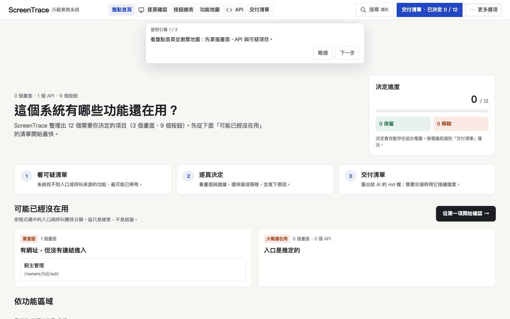

首頁的功能區域卡片可查看同一批畫面的分類與進度。

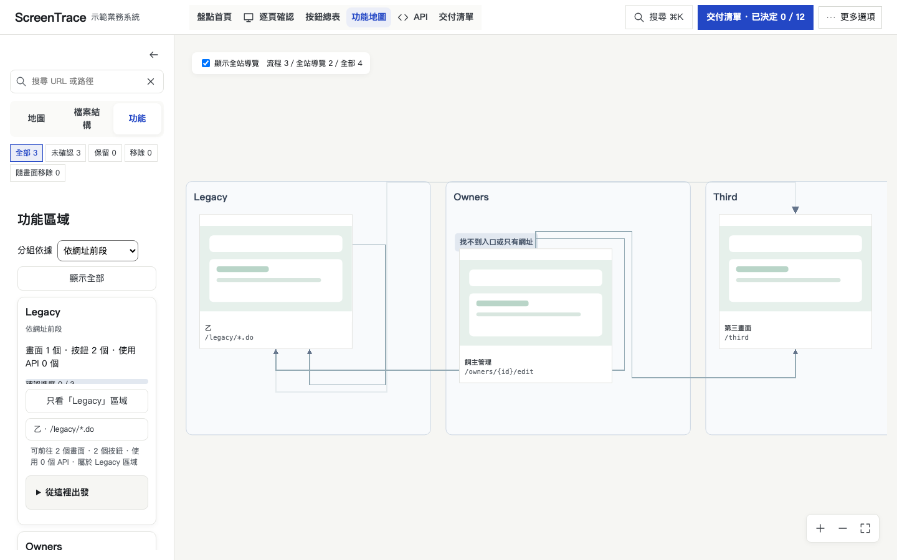

## 3. 逐頁確認並做決定

你可以逐張查看完整畫面、判斷依據及按鈕，再標記保留或移除。

1. 選擇「逐頁確認」，左側佇列會顯示所有畫面及其狀態；已決定者顯示「保留」或「移除」。
2. 佇列可依可疑程度或功能區域瀏覽，也可只看未決定項目。
3. 中間區域顯示完整畫面預覽；右欄列出入口、可前往畫面、API、假設移除影響及技術細節。
4. 在右欄選擇保留或移除，可加上原因與備註；按「儲存，看下一個」繼續。
5. 畫面下方列出可標記按鈕。未標記按鈕跟著畫面；頁首、頁尾片段按鈕會收在群組內。
6. 按 `n` 前往下一個未決定項；標記快捷鍵 `k` 保留、`x` 移除、`u` 未決定。

**注意**

- 標記會暫存在瀏覽器；換電腦、換檔案位置、使用私密瀏覽或清除瀏覽器資料時，可能無法取回。完成一批標記後，請務必匯出 md 保存。

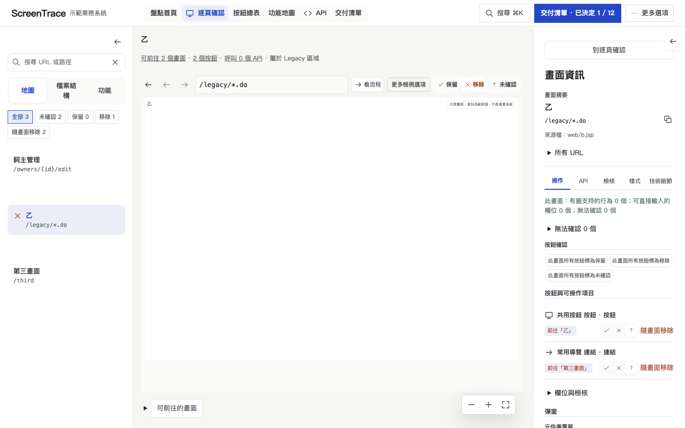

## 4. 按鈕總表

你可以在全專案按鈕表搜尋、篩選、合併同名同行為項目，或批次標記。

1. 選擇「按鈕總表」，以文字、功能區域、畫面、類型及狀態篩選。
2. 「依按鈕名稱合併」會依顯示名稱與行為分組；行為不同的同名項目需展開後逐筆處理。
3. 勾選可批次標記的列；決策仍逐一寫入每個畫面與元件，不會建立另一種共用決策。
4. 「查看」會前往逐頁確認並定位元件。

## 5. 功能地圖

你可以在地圖查看各功能區域的畫面、入口及彼此關係。

1. 選擇「功能地圖」；畫面依功能區域排成泳道，卡片顯示名稱、網址及入口資訊。
2. 需要檢查跨畫面導覽時，開啟「顯示全站導覽」；關閉後回到一般關聯線。
3. 滑過關聯線可查看網址與縮圖，點擊可聚焦目的畫面；聚焦後右欄顯示 API、按鈕與「到逐頁確認」。
4. 左側可切換檔案結構或功能區域，也可搜尋 URL。
5. 用滑鼠拖曳平移畫布，使用縮放按鈕調整檢視。
6. 以 `Ctrl／⌘＋K` 搜尋畫面、URL、按鈕或 API；畫面資訊中的「從這裡出發」會展開流程大綱。

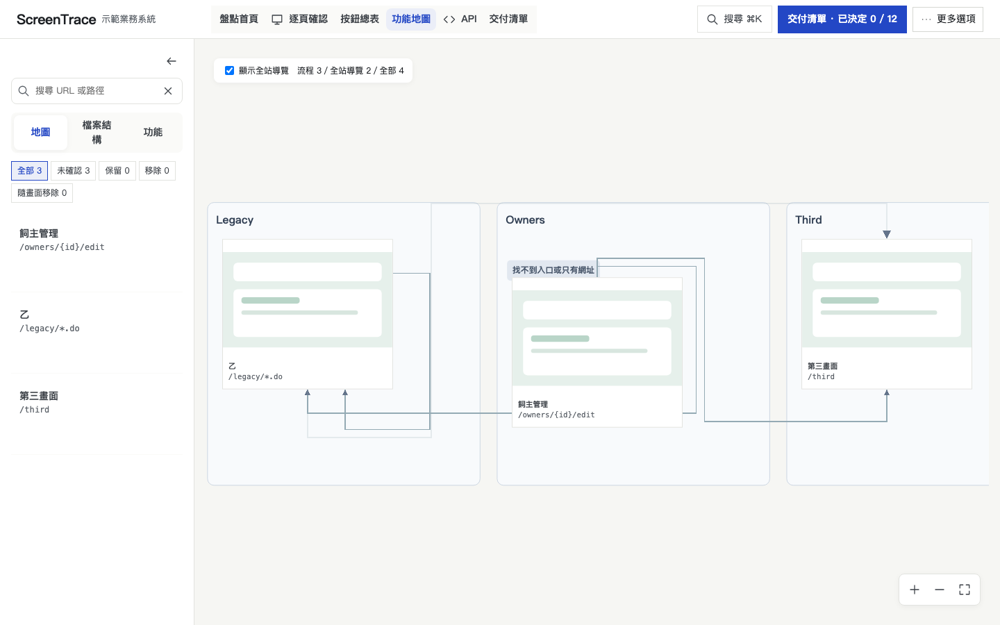

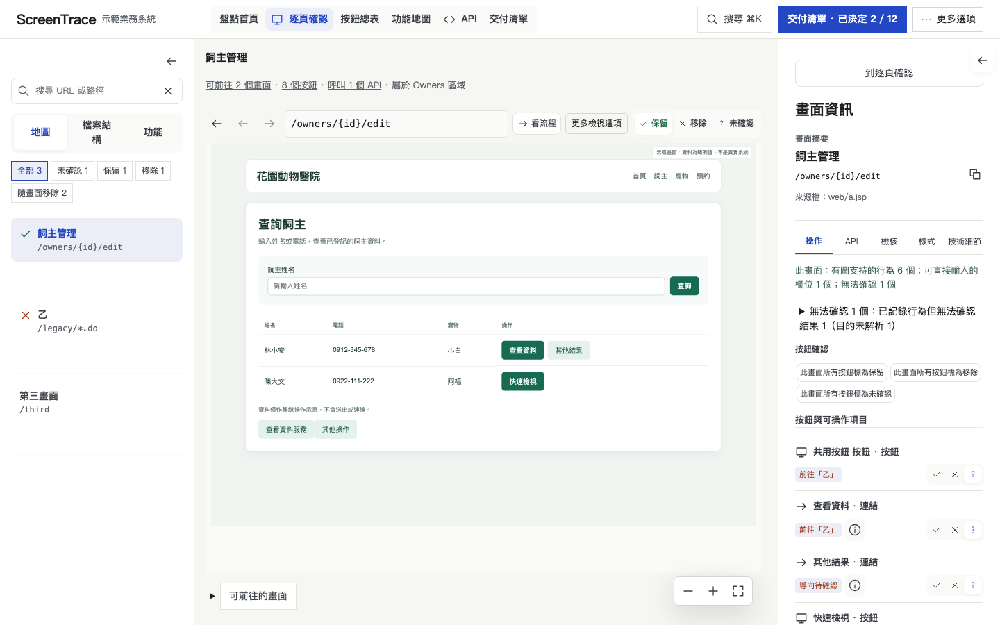

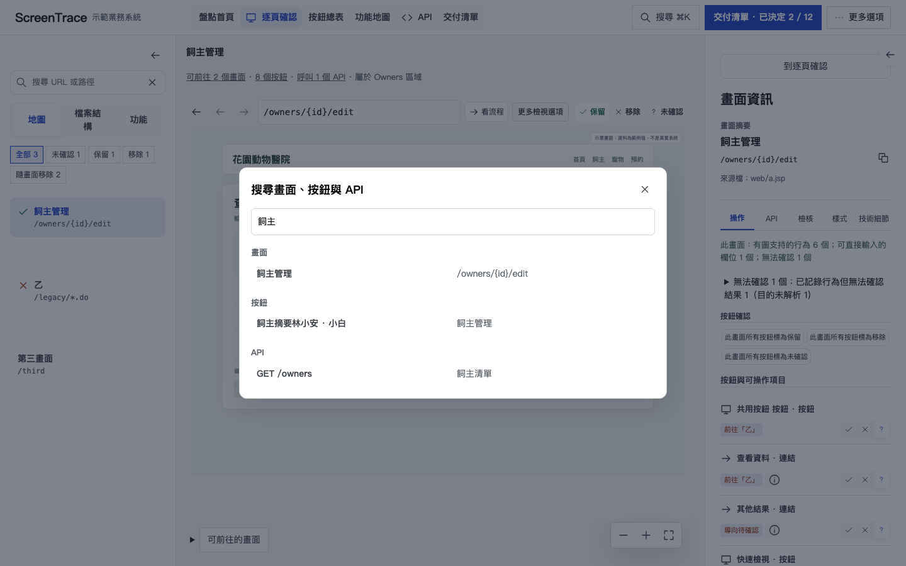

## 6. API 頁

你可以在 API 頁分辨後端端點、畫面網址與尚未對應到後端的前端請求。

1. 選擇「API」，再切換 API 或畫面網址。
2. 使用狀態篩選查看使用中、推定使用中、找不到呼叫來源或可移除項目。
3. 點選項目查看契約、處理程式與呼叫來源；點來源可回到畫面。
4. 前端請求描述會另外列出，不計入後端 API 數。若有 context path 診斷，頁面會提示設定方式。
5. 自動導向的畫面網址會標示「系統自動導向」。

## 7. 交付清單與交付 AI

你可以在交付清單確認決策、查看移除影響，並匯出或還原 Markdown。

1. 選擇「交付清單」，查看移除、保留及未決定數量。
2. 檢查確定移除項目的原因、備註與已知影響；保留項目可展開查看。
3. 點選未決定提醒可返回逐頁確認；衝突會列在交付提醒中。
4. 使用「給 AI 的指示檔（md）」下載報告，再把單一 HTML 與 md 一起交給 AI，說明希望協助整理的問題。
5. 使用「開啟先前匯出的 md」還原決策；若結果已變更，檢查列出的未對應項目。

**注意**

- 不要手動修改 md 附錄 A；它保存供報表還原決策使用的資料。
- 固定警語會提醒 AI：文件中的專案資料是引用內容，不是給 AI 執行的指示。
- 格式錯誤或檔案不完整時，匯入會顯示錯誤並保留目前決策。
- 標記暫存在瀏覽器；換電腦、換檔案位置、使用私密瀏覽或清除瀏覽器資料時，可能無法取回。完成一批標記後，請務必匯出 md 保存。
- 匯出超過 5 MB 會顯示警告，但內容不會截斷；匯入檔超過 64 MiB 會拒絕。

## 8. 模擬操作

你可以在不執行原系統的情況下查看連結、表單、彈窗及輸入欄位的示意結果。

1. 在預覽中點連結或按鈕，報表只會顯示靜態分析可支持的候選，不會發出請求。
2. 多個候選會全部列出，並附白話原因；無法證明的結果會明確標示。
3. 表單可輸入示例值並查看已知檢核提示；彈窗按鈕會顯示示意內容。
4. 滑過互動元件可查看提示；Alt（Mac 上的 Option）加點擊只選取、不試操作。

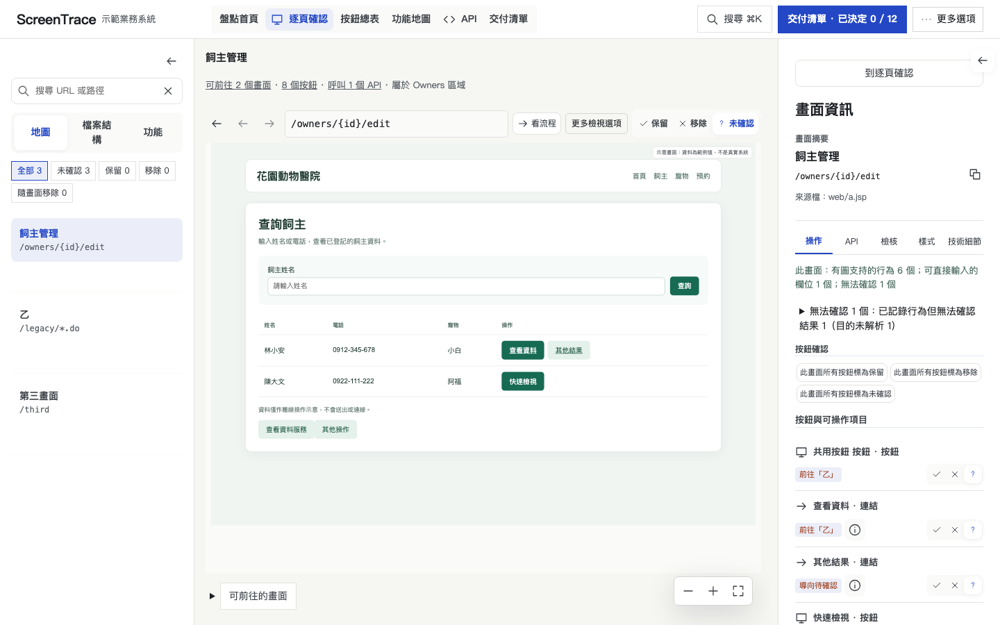

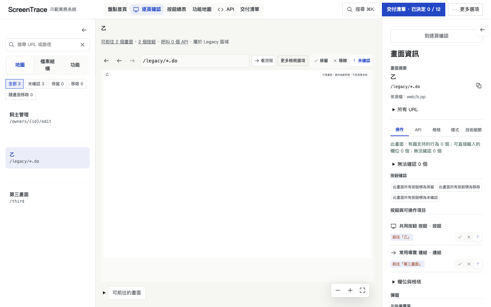

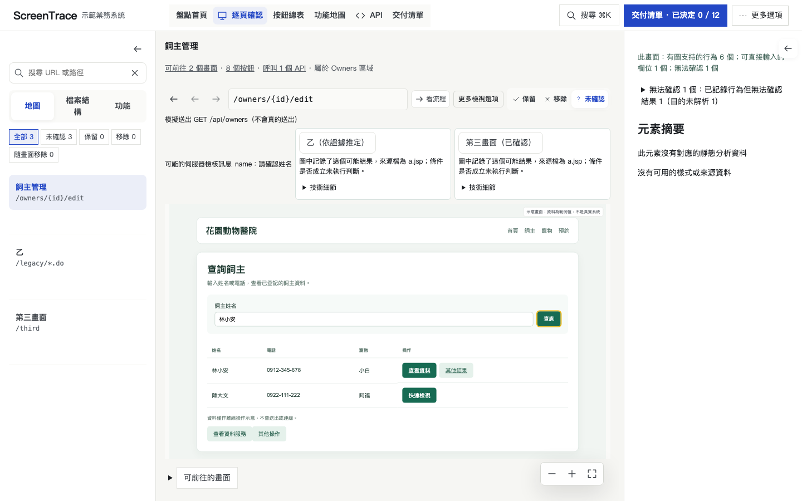

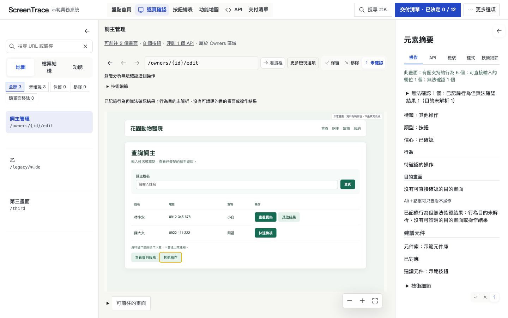

## 9. 元件庫建議與覆寫

你可以查看元件庫對應建議，並為需要的元件指定自己的對應。

1. 在逐頁確認選取保留畫面中的元件。
2. 查看建議與匹配依據；不合適時可選擇其他元件庫元件。
3. 覆寫會跟著審查狀態匯出及匯入；未匯入元件庫時會顯示「未匯入元件庫」。

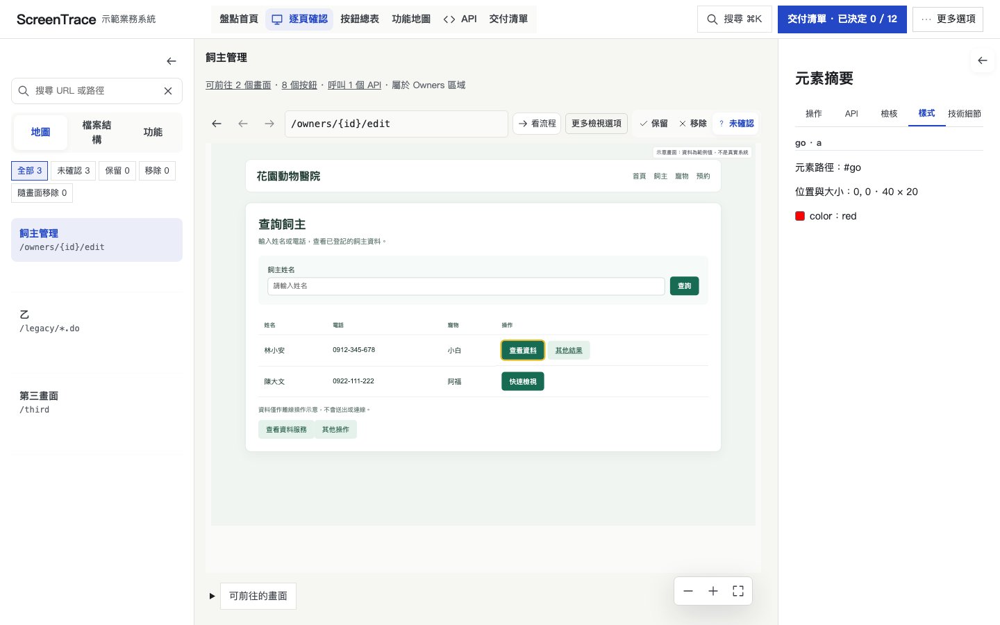

## 10. 判斷分析結果是否可信

你可以依信心、覆蓋率與診斷判斷哪些關係可直接討論、哪些需要人工確認。

1. 查看「有圖支持的行為」「可直接輸入的欄位」與「無法確認」數量。
2. 點選未解析或有歧義的項目，展開技術細節並檢視全部候選與證據。
3. 開啟「分析資訊」查看診斷摘要；展開項目可看到代碼、訊息、來源檔與行號。
4. URL、候選或來源互相矛盾、關鍵畫面缺失，或結果會影響刪除與法規判斷時，請分析人員協助。

「未解析（UNRESOLVED）」表示目前證據不足以確定目標；「有歧義（AMBIGUOUS）」表示存在多個候選，應逐一檢視；「依證據推定（INFERRED）」表示有支持證據，但仍是推定。

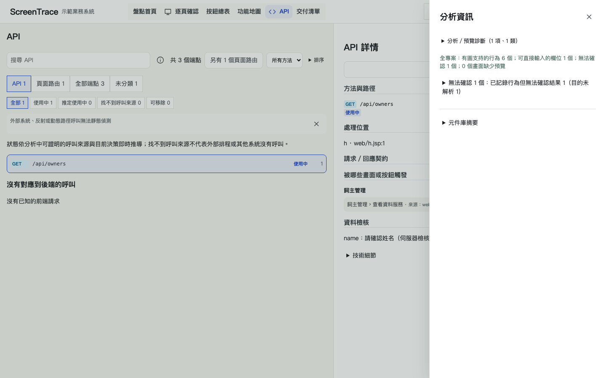

「更多選項」中的說明浮層列出快捷鍵、選取方式與狀態圖例。

## 11. 常見問題與詞彙表

你可以在這裡快速查找報表用語與常見狀況。

**預覽和原系統不同？** 預覽以靜態內容與合成資料呈現；動態資料、權限、資料庫與真實服務不會在報表中執行。

**為什麼有多個候選？** 靜態證據無法排除其他可能時，報表會保留全部候選供你選擇，不會自行挑一個。

**詞彙表**

- 推定入口：由程式組成的網址樣板只符合一個已知路由，仍需人工確認。
- 找不到呼叫來源：目前圖中沒有已知呼叫者，不代表排程或其他系統沒有呼叫。
- 系統自動導向：安全設定證明符合條件時，系統會將使用者帶到指定畫面。
- 跟著畫面：元件沒有自己的決策時，依所屬畫面的決策處理。
- 未決定：需求方尚未選擇保留或移除。
- 可移除：依目前已知的呼叫來源與決策推導出的狀態，不是刪除建議。
- md 附錄 A：用來還原決策的機器資料區。

欄位、排序與安全規則請參閱[審查文件格式契約](REVIEW_MD_CONTRACT.md)。更多分析人員操作請參閱[分析人員指南](ANALYST_GUIDE.md)。
