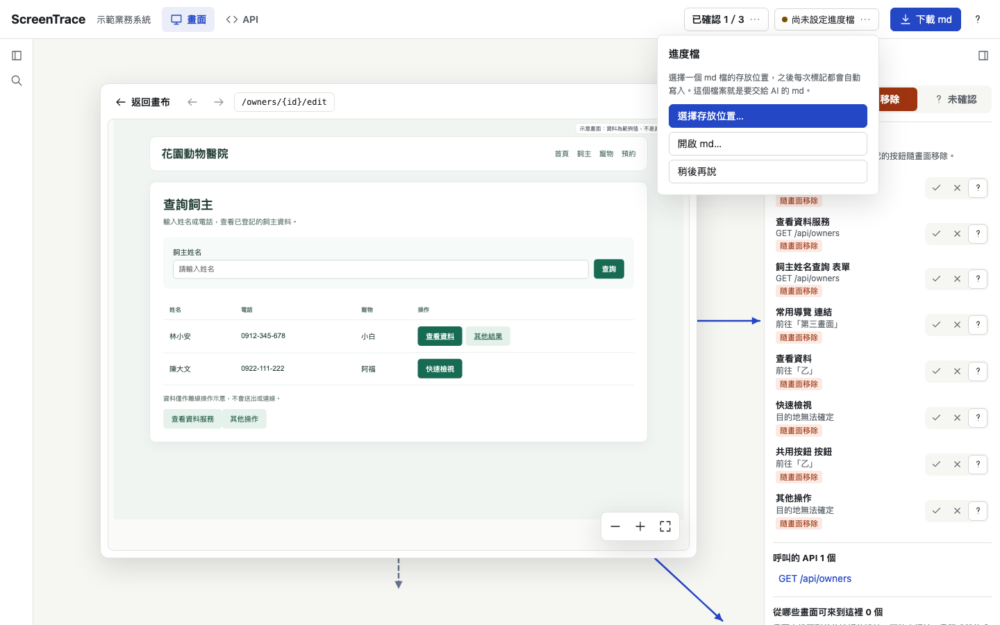
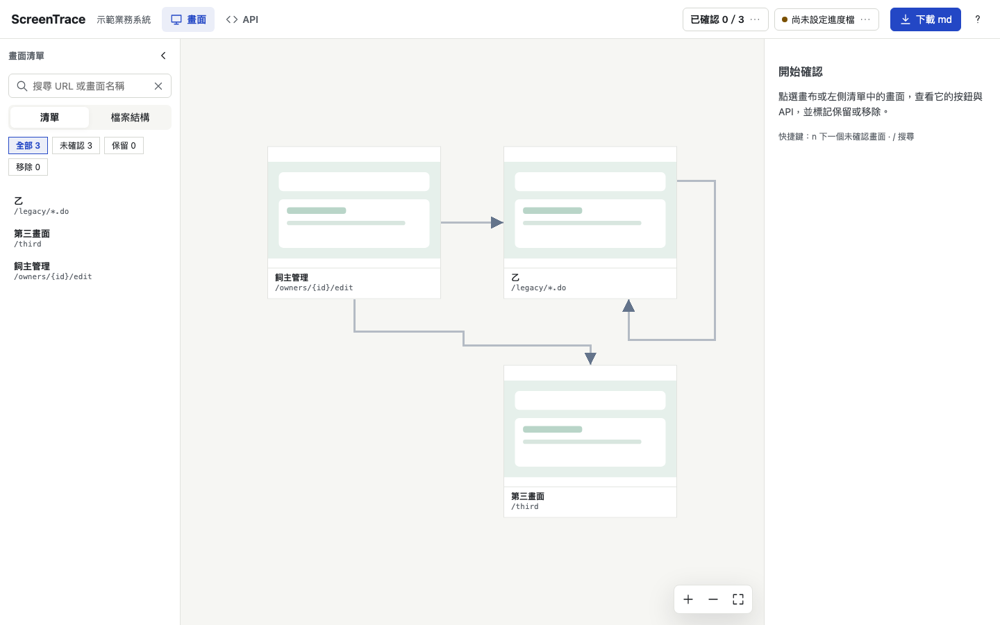
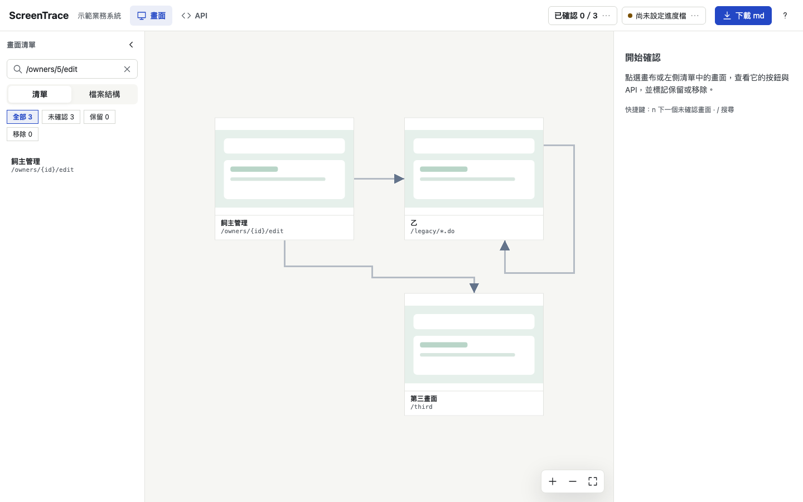
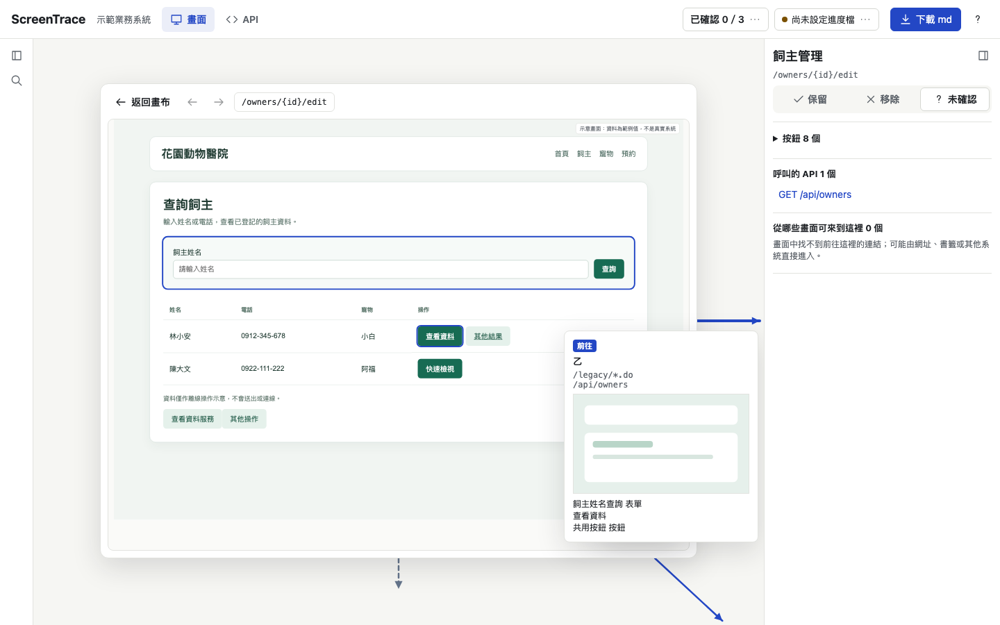
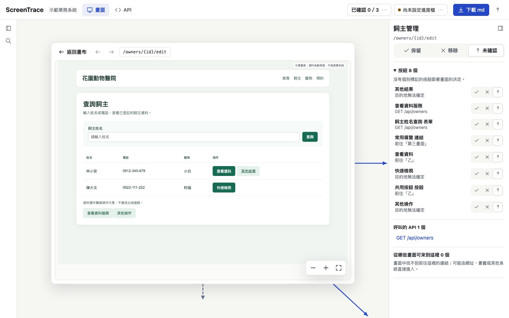
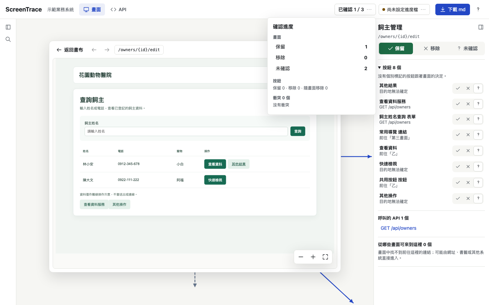
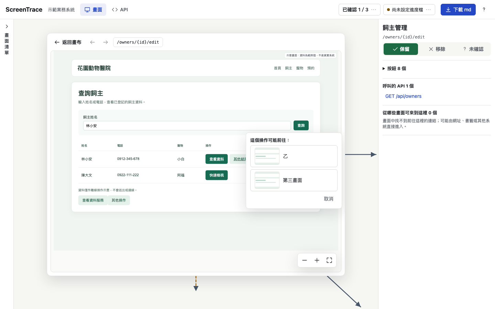
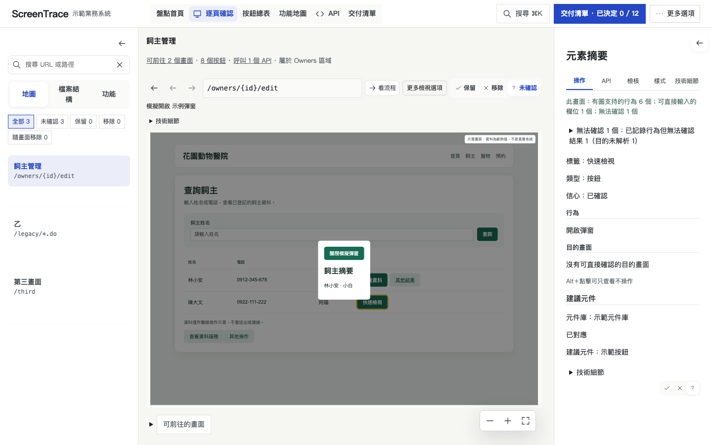
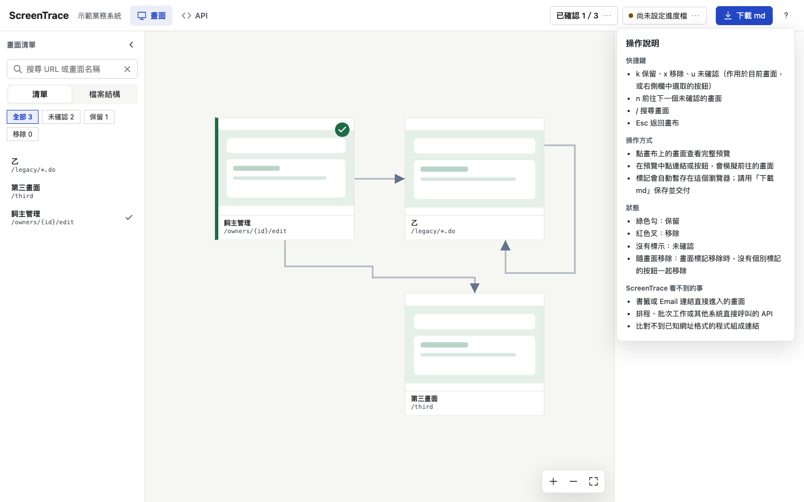

# 報表使用指南

## 1. 了解確認流程

你可以用這份報表看懂系統有哪些畫面、每個畫面能做什麼，並標記哪些畫面和按鈕要保留、哪些可以移除，最後把結果交給 AI。

流程只有四步：

1. 在畫布上找到畫面，點進去看完整預覽。
2. 在預覽裡點按鈕，看看會前往哪裡。
3. 在右側標記「保留」或「移除」。
4. 進度會自動存成 md 檔；確認完把這個 md 交給 AI。

報表是靜態分析與合成資料產生的離線示意，不會啟動或修改被分析專案，也不會執行專案腳本、不連線或送出真實資料。畫面中的資料是範例值。本指南的截圖皆來自自行撰寫的合成專案，不代表實際客戶系統。

**注意**：未被使用不等於可刪除。書籤、排程或其他系統直接呼叫的畫面與 API，報表看不到；刪除前仍應向相關人員確認。

## 2. 開始：打開報表與保存進度

你可以直接用瀏覽器打開收到的單一 HTML 檔，不需要安裝任何東西或連線網路。建議使用 Chrome 或 Edge。

1. 用 Chrome 打開報表。頂部有「畫面」「API」兩個分頁、確認進度、進度檔、「下載 md」與說明（?）。
2. 第一次標記保留或移除時，「進度檔」選單會自動展開，請按「選擇存放位置…」選一個位置存 md 檔。之後每次標記都會自動寫入這個檔案，選單顯示「已自動儲存」。
3. 下次打開報表，選單會顯示「繼續上次進度」，點一下並允許瀏覽器存取檔案，就會接續上次的標記。
4. 想之後再設定，可以按「稍後再說」。

**注意**

- 沒有設定進度檔時，標記只暫存在瀏覽器；換電腦、換檔案位置、使用私密瀏覽或清除瀏覽器資料時，可能無法取回。請設定進度檔，或完成一批標記後用「下載 md」匯出 md 保存。
- Safari、Firefox 不支援自動存檔，選單會顯示「未自動存檔」。請用「下載 md」保存，之後用選單裡的「開啟 md…」接續。
- 儲存失敗時，選單會顯示原因；標記仍留在頁面上，可以按「重試」或改選位置。

## 3. 在畫布上找畫面

你可以在畫布上看到所有畫面和它們之間的關聯線，用搜尋快速找到特定畫面。

1. 畫布上每張卡片是一個畫面，箭頭線代表「從這個畫面可以前往那個畫面」。頁首、頁尾這類每頁都有的共用連結不畫線；可以從頁首或頁尾進入的畫面，卡片左上角會有一個選單圖示，滑過可以看到有幾個畫面連到這裡。
2. 用滑鼠拖曳平移、滾輪縮放，或用右下角的放大、縮小、適合畫面按鈕。
3. 滑過卡片會標出它的關聯線：藍色是從這個畫面出去的線，橘色是進到這個畫面的線，其他線會淡化。滑過一條線會標出這條線和它兩端的畫面；點線就前往目的畫面。
4. 往後續步驟的線從卡片右側出、左側進；繞回前面畫面的線走在卡片下方（或上方）。

   畫面較多（超過 12 個）時，像「登入」「首頁」這種一半以上畫面都能直接前往的畫面，總覽不再從每個畫面畫線過去，改在它的卡片左上角顯示橘色的「→ 數字」，代表可從幾個畫面直接前往；放大畫面時這些線照常顯示。畫面超過 20 個時，關聯線平常會淡化，滑過畫面或線才清楚顯示。
5. 左側搜尋框可以輸入實際網址（例如 `/owners/5/edit`）或畫面名稱，符合的畫面會在清單與畫布上標出。

   畫面名稱取自畫面的標題；幾個畫面標題相同時，名稱後面加上網址區分，例如「預約中心（/reservation/today/manage）」。標題是動態內容或沒有標題時，改用程式中的元件名稱（英文）。只會轉到其他畫面、本身沒有內容的網址，會顯示為「轉址到「某畫面」」，通常可以考慮移除。
6. 左側可切換「清單」或「檔案結構」，也可以用「全部／未確認／保留／移除」篩選。

## 4. 查看畫面並標記保留或移除

你可以點進畫面看完整內容，並在右側欄標記這個畫面和它的按鈕。

1. 點畫布上的畫面或左側清單，畫布會放大到這個畫面，中間顯示完整預覽。左側清單會收起，只留下左上角的側欄按鈕和搜尋按鈕；點側欄按鈕，清單會浮在畫布上方，不會擠小預覽。選好畫面、按 Esc 或點清單外的地方，清單就會自動收回。
2. 預覽四周留下這個畫面的關聯線，方向和原本畫布上一樣：藍色是從這裡出去的線，橘色是從其他畫面進來的線。滑過藍線可以看到目的畫面的縮圖，以及預覽中是哪些按鈕會前往那裡；滑過橘線可以看到來源畫面和它上面的按鈕。點線就移到那個畫面。
   框上方的虛線代表頁首、頁尾的共用連結：橘色是「從幾個畫面的頁首／頁尾連進來」，藍色是「這個畫面的頁首／頁尾可以前往幾個畫面」。點標籤會列出這些畫面，選一個就前往。
3. 框下方的灰色短虛線表示「無法確定前往哪個畫面」的出口，例如程式組成的網址。
4. 右側欄上方選擇「保留」「移除」或「未確認」。
5. 「按鈕」預設收合，展開後每個按鈕可以個別標記。沒有個別標記的按鈕跟著畫面的決定；畫面標記移除時，這些按鈕會顯示「隨畫面移除」。按鈕依預覽中的位置由上而下排列，同名按鈕的「第 N 個」也依這個順序編號。滑過按鈕名稱，預覽會用虛線框出它；點按鈕名稱，預覽會捲動到它並以黃框標示。反過來，在預覽中點按鈕，右側清單會跳到對應的那一列。頁首、頁尾的按鈕收在另一組；只在特定情況下出現（例如點了才開啟的視窗）的按鈕收在「預覽中未顯示」。
6. 右側欄也列出這個畫面呼叫的 API，以及「從哪些畫面可來到這裡」。只透過頁首／頁尾連過來的畫面收在「透過頁首／頁尾連結」分組裡，和預覽上方的橘色虛線對應。
7. 右側欄只在打開畫面時出現；在畫布總覽時隱藏，讓畫布更寬。想讓預覽更大，可以按右側欄右上角的側欄按鈕收起，收起後快捷鍵照樣能標記；回到畫布前，換到其他畫面也會維持收起。
8. 按「返回畫布」或 Esc 回到畫布總覽。

頂部的「已確認」可以展開，查看保留、移除、未確認的數量，以及衝突（保留的按鈕卻會前往已標記移除的畫面）。點數量可以篩選左側清單。

**快捷鍵**：`k` 保留、`x` 移除、`u` 未確認（作用於目前畫面，或右側欄中選取的按鈕）；`n` 前往下一個未確認的畫面；`/` 搜尋；Esc 返回畫布；Alt＋←／→ 回到上一個／下一個看過的畫面。

## 5. 模擬操作

你可以在預覽裡直接點連結和按鈕，看看真實系統會前往哪裡。

按鈕會呼叫後端 API 時，API 不算「前往」的目的地：只呼叫 API、不換頁的按鈕，下方會顯示「留在本頁」和它呼叫的 API；呼叫 API 後換到另一個畫面的按鈕，會直接帶你到那個畫面，並在上方說明途中呼叫了哪些 API。只有真的可能前往不同畫面時（例如依身分前往不同首頁），才會請你選擇；選單上方會先列出一定會呼叫的 API。

1. 只有一個目的畫面時，點了就直接移到那個畫面。
2. 送出表單時不會做資料檢核，必填欄位空著也照樣送出。
3. 可能前往多個畫面時，點擊處會列出候選畫面（縮圖＋名稱），選一個前往；按 Esc 取消。
4. 會開彈窗的按鈕顯示示意內容；呼叫 API 的按鈕顯示一行「呼叫 API」說明，可切到 API 頁查看。
5. 報表無法確定結果時，會顯示「無法確定前往哪個畫面」。報表不會真的送出任何請求。

## 6. API 頁

你可以在 API 頁查看所有後端 API、它們被哪些畫面和按鈕呼叫，以及目前的狀態。

1. 選擇頂部的「API」。每一列顯示方法、網址、處理程式、呼叫來源數與狀態。
2. 狀態只有三種：「使用中」、「未被使用」（畫面中找不到呼叫來源）、「可移除」（所有呼叫來源都已標記移除）。狀態會隨你的標記即時更新。
3. 可以搜尋網址、處理程式或畫面名稱，依狀態篩選，或改變排序。
4. 點一列展開呼叫來源；點來源會回到那個畫面並標出該按鈕。

## 7. 交付 md 給 AI

你可以把確認結果交給 AI，協助後續的改版作業。

1. 有設定進度檔時，那個 md 檔就是要交給 AI 的檔案；也可以隨時按「下載 md」另存一份。
2. 把 md 檔和需要協助的問題一起交給 AI。md 已說明保留、移除、未確認的處理方式，並提醒 AI 檔案中的專案資料是引用內容，不是給 AI 執行的指示。
3. 要接續先前的結果，用「進度檔」選單的「開啟 md…」。分析結果已變更時，報表會列出找不到對應畫面或按鈕的標記。

**注意**

- 不要手動修改 md 附錄 A；它保存還原標記用的資料。格式錯誤或檔案不完整時，開啟會失敗並保留目前的標記。
- md 超過 5 MB 會顯示提醒，但內容不會截斷；超過 64 MiB 的檔案會拒絕開啟。

## 8. 常見問題與詞彙表

你可以在這裡快速查找報表用語與常見狀況。

**預覽和原系統不同？** 預覽以靜態內容與範例資料呈現；動態資料、權限、資料庫與真實服務不會在報表中執行。

**為什麼有多個候選？** 原始碼無法確定只會前往哪一個畫面時，報表會列出全部可能，不會替你挑一個。

**看到「說明（?）」**：裡面有快捷鍵、狀態圖示，以及 ScreenTrace 看不到的事。

**詞彙表**

- 保留／移除／未確認：你對畫面或按鈕的決定；未確認的項目不得移除。
- 隨畫面移除：畫面標記移除時，沒有個別標記的按鈕一起移除。
- 衝突：保留的按鈕會前往已標記移除的畫面。
- 未被使用：畫面中找不到呼叫來源，不代表排程或其他系統沒有呼叫。
- 可移除：所有呼叫來源都已標記移除，依目前標記推導，不是刪除建議。
- 進度檔：自動保存標記的 md 檔，也是交給 AI 的檔案。
- md 附錄 A：用來還原標記的機器資料區。

更多分析人員操作請參閱[分析人員指南](ANALYST_GUIDE.md)。
