# R14：功能盤點工作台（WP44–WP47）

**範圍：**WP44 A1–A4、WP45、WP46、WP47。WP44 資料層已通過；WP45、WP46 首次介面驗收未通過，依需求方 2026-10-09 的 §9.1–§9.5 完成補正並等待重新驗收。以下「WP45–WP47 §9 補正」為本報告的現況；其後最初提交的畫面敘述僅作歷史紀錄。轉址目的地只在唯一可證明時繼承原呼叫來源，並保持 INFERRED；Java 與 TypeScript 共用向量一致。依第三次驗收授權，`GET /orders/{name}` 的狀態移動同步更新 golden。


## WP45–WP47 §9 補正（WP48–WP50 實作前基準）

依需求方 0d06db3、e0179c2 的驗收回覆，WP45／WP46 介面補正與 WP47 原因標籤已各自獨立提交：`69feaff`、`93208f1`、`0c5a6ce`。失敗測試提交先於實作：WP45 的 `22c1ab6`／`79dd889` 鎖定匯出移入「更多選項」與匯入回饋；WP46 的 `ec98e30` 鎖定三欄結構；WP47 的 `bfeb08b` 鎖定原因欄文字。更新斷言與舊控制項搬移的逐處理由列於 [ADR 0070](../adr/0070-r14-design-system-and-review-layout.md)。舊版 `8687d38` 的新結構斷言實測失敗：WP46 左側三個篩選預期 3、實際 0；WP47「移除原因」預期該文字、實際「原因」；WP45 匯入完成回饋在「更多選項」收合後預期可見、實際不可見。舊版 Chromium 初次啟動受 sandbox Mach bootstrap 限制；升權在隔離舊版重跑後取得上述斷言結果。

最終以唯讀專案重新執行分析與報表；所有 CLI 標準輸入皆為 `/dev/null`，context path 只在暫存 workspace `config.json`，分析輸出留在暫存輸出根目錄。沒有執行目標專案、修改目標檔案或發出網路請求。實際命令如下（暫存 home 以描述名稱代稱）：

```sh
java -Duser.home=<tmp-home-emusic-no-context> -jar screentrace-cli/target/screentrace-cli-0.1.0-SNAPSHOT.jar analyze eMusicStore_eCommerce_Website < /dev/null
java -Duser.home=<tmp-home-emusic-no-context> -jar screentrace-cli/target/screentrace-cli-0.1.0-SNAPSHOT.jar report eMusicStore_eCommerce_Website < /dev/null
java -Duser.home=<tmp-home-emusic-context-path> -jar screentrace-cli/target/screentrace-cli-0.1.0-SNAPSHOT.jar analyze eMusicStore_eCommerce_Website < /dev/null
java -Duser.home=<tmp-home-emusic-context-path> -jar screentrace-cli/target/screentrace-cli-0.1.0-SNAPSHOT.jar report eMusicStore_eCommerce_Website < /dev/null
java -Duser.home=<tmp-home-petclinic> -jar screentrace-cli/target/screentrace-cli-0.1.0-SNAPSHOT.jar analyze spring-framework-petclinic < /dev/null
java -Duser.home=<tmp-home-petclinic> -jar screentrace-cli/target/screentrace-cli-0.1.0-SNAPSHOT.jar report spring-framework-petclinic < /dev/null
```

三份最終報表以 Chromium `file://` 開啟後讀取畫面及檔案大小。入口分類依連結網址取得方式：eMusicStore 兩種設定皆為推定入口 3、找不到入口 1、自動導向 1、有入口 6。首頁 API 統計只計 API 類別，不把畫面路由或前端請求描述算入；缺 context path 時首頁列 7 個 API（其中 5 個找不到呼叫來源），有 context path 時仍為 7 個（其中 1 個找不到呼叫來源）。PetClinic 首頁為 2 個 API。分析日期沒有資料的三份報表都省略日期區塊；eMusicStore 無設定的 4 個 `CONTEXT_PATH_HINT` 呼叫提醒位於可疑清單上方，設定後不顯示。

| 實際開啟的報表 | 首頁摘要 | 入口分類（推定／無入口／自動導向／有入口） | 首頁功能區域依據與畫面分布 | 逐頁佇列 | HTML 大小 |
|---|---|---|---|---:|---:|
| eMusicStore，無 context path | 11 畫面 · 7 API · 118 按鈕；4 個 context path 呼叫提醒；未引用 API 卡 5 個 | 3／1／1／6 | 網址前段；Admin 5、Cart 1、Login 1、Product List 2、首頁與其他 2 | 11 | 3,881,665 bytes |
| eMusicStore，設定 `/eMusicStore` | 11 畫面 · 7 API · 118 按鈕；無提醒；未引用 API 卡 1 個 | 3／1／1／6 | 網址前段；同上 | 11 | 3,901,232 bytes |
| PetClinic | 10 畫面 · 2 API · 68 按鈕；無提醒 | — | JSP 目錄；Owners 4、Pets 2、Vets 1、首頁與其他 3 | 10 | 3,762,820 bytes |

功能區域的三種依據由報表下拉選單逐一切換，直接讀取各區域卡片數及單畫面區數：

| 專案 | 網址前段（區域／單畫面） | 控制器類別（區域／單畫面） | JSP 目錄（區域／單畫面） | 預設選擇 |
|---|---:|---:|---:|---|
| eMusicStore | 5／2 | 5／3 | 1／0 | 網址前段；依 §2.2 排除只有 1 區的 JSP 依據後，單畫面區數 2 少於控制器的 3 |
| PetClinic | 4／3 | 7／5 | 4／1 | JSP 目錄；單畫面區數最少 |

以下並排圖左側是設計稿，右側是 Chromium 實際畫面。實作截圖為 1440×900；圖上沒有另外加註解條或覆蓋標籤。首頁與逐頁確認都以合成 fixture、eMusicStore 報表截圖，已決定比較分別對應移除畫面與原因欄、單一按鈕保留狀態。

| 區域 | 設計稿／合成 fixture | 設計稿／eMusicStore |
|---|---|---|
| 首頁 | 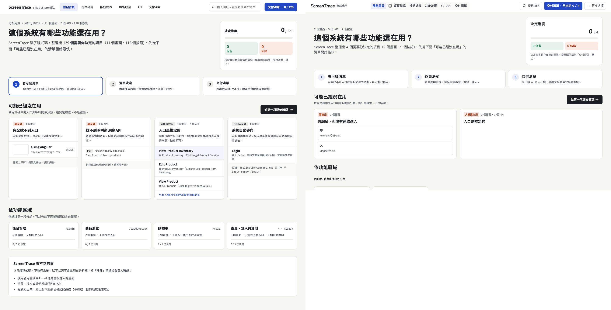 | 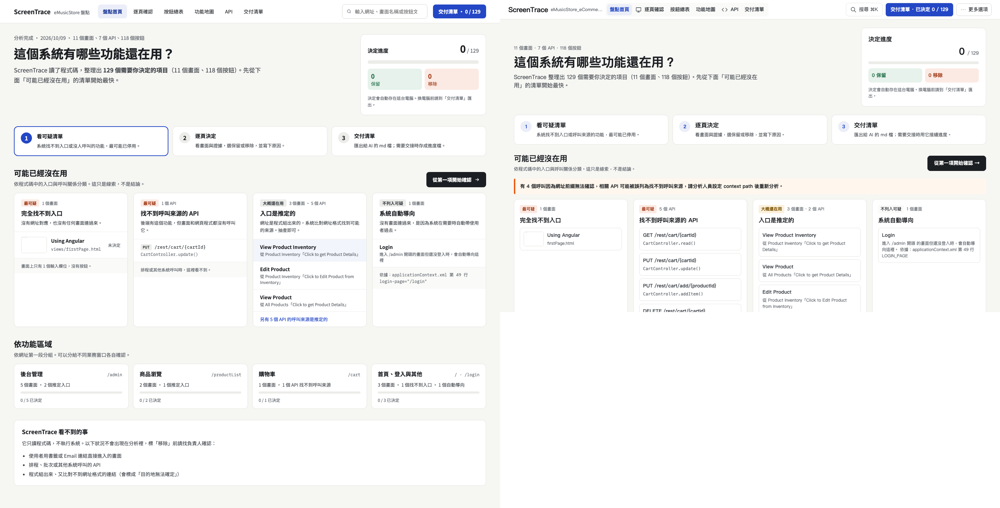 |
| 逐頁確認・未決定 | 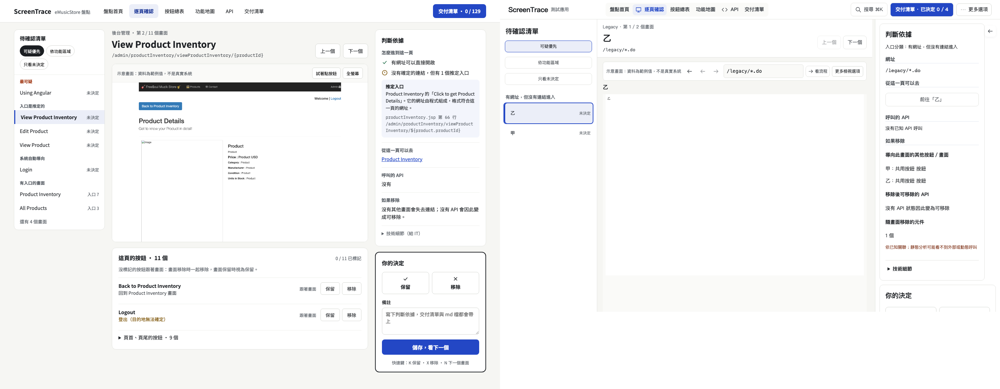 | 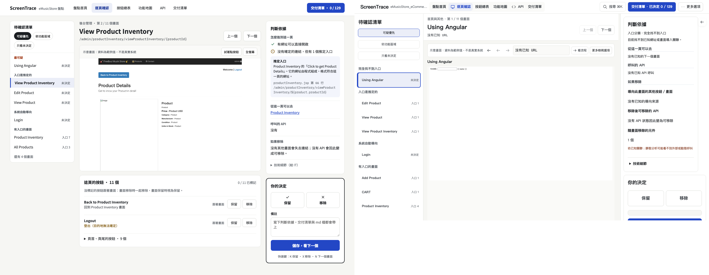 |
| 逐頁確認・已決定 | 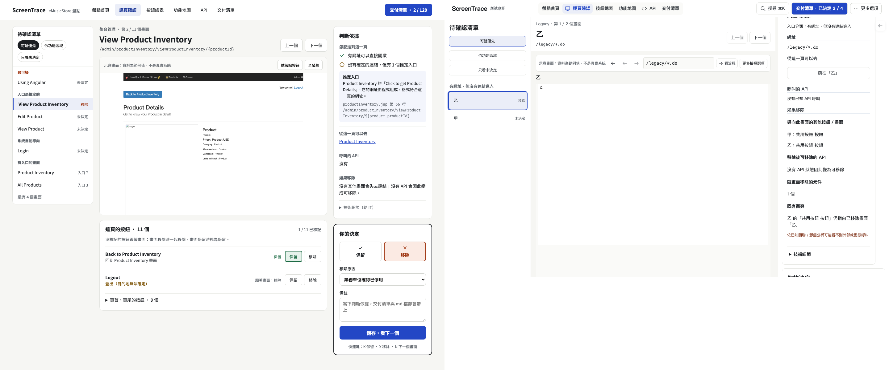 | 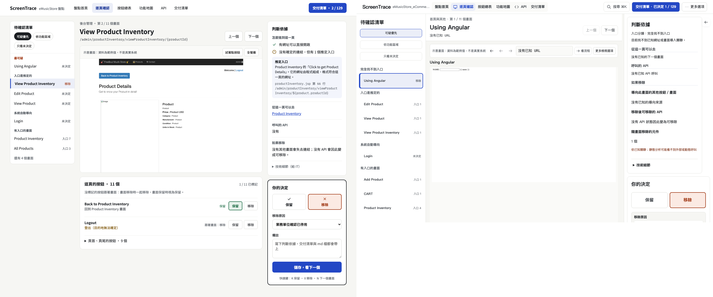 |

### 首頁逐區核對

| 區域 | 設計稿 | 實作 | 結果與差異原因 |
|---|---|---|---|
| 頂部列 | 品牌與專案名、六分頁、搜尋、交付進度、「⋯」 | 六項分頁文字完整；交付進度顯示 `已決定 N / 總數`；匯出 md 在「⋯」第一項 | 一致；舊確認進度入口與頂列直接匯出位置已移除，原能力分別由首頁／交付清單及「⋯」提供 |
| 專案摘要與進度 | 日期、畫面／API／按鈕、主標題、總決定數與右側進度 | 數字由各圖計算；無分析日期時日期整段省略 | 一致；PetClinic 與 eMusicStore 的分類數依圖而異，沒有複製示意數字 |
| 三步驟 | 看可疑清單、逐頁決定、交付清單 | 三張步驟卡依順序呈現 | 一致 |
| context path 提醒 | 未解析呼叫提醒置於可疑項目上方 | eMusicStore 無設定顯示 4 個呼叫；有設定及 PetClinic 不顯示 | 一致；只提醒，不自動套用前綴 |
| 可疑卡片 | 依入口類別分卡，依圖顯示名稱、來源或 handler | eMusicStore 無設定顯示 1 個無入口畫面、5 個未引用 API、3 個推定畫面與 2 個推定 API、1 個自動導向畫面；有設定的推定 API 為 6、未引用 API 為 1 | 一致；`7 個 API` 是首頁 API 類別總數；卡片只計該分類下的端點。自動導向證據只顯示檔名與行號，不顯示完整專案路徑 |
| 功能區域 | 顯示全專案選用的單一分組依據、區域名與畫面數 | eMusicStore 依網址分 5 區，PetClinic 依 JSP 目錄分 4 區 | 一致；策略依 §2.2 的區域數與單畫面區數計算 |
| 分析限制 | 固定列出書籤／外部 API／無法辨識組成網址限制 | 三項限制仍顯示於首頁下方 | 一致；長內容在視窗內向下捲動 |

### 逐頁確認逐區核對

| 區域 | 設計稿 | 實作 | 結果與差異原因 |
|---|---|---|---|
| 左欄佇列 | 佇列標題、三個篩選、可疑分組、狀態與入口數 | 約 280px；僅有「待確認清單」、三個切換鈕、分組和項目，列全 11／10 個畫面 | 一致；依 §8.1 刻意列出完整清單。地圖、檔案結構、功能導覽與 URL 搜尋仍可在功能地圖／全域搜尋使用 |
| 單列 | 畫面名與狀態或入口數 | 同一行顯示名稱與右側狀態／入口數，不顯示 URL | 一致 |
| 中間頁首 | 區域與頁次、單一畫面標題、URL、上一個／下一個 | 一個 h1；工具列及內容不重複第二個畫面標題或摘要行 | 一致；無可證明 URL 的 fixture 依原規則顯示「沒有已知 URL」 |
| 預覽列 | 範例資料提示與既有檢視器控制 | `示意畫面：資料為範例值，不是真實系統`、完整檢視器、流程／檢視／全螢幕控制；工具列無決策按鈕 | 一致；沿用既有互動檢視器而非靜態截圖 |
| 預覽下方按鈕 | 按鈕名、白話行為、目前狀態、保留／移除文字按鈕 | 元件列於預覽後、同一複合決策鍵；片段來源可收合 | 一致；右欄不重複列元件。不同資料量會改變列數 |
| 右欄第一卡 | 判斷依據、入口／目的地／API／假設移除影響、收合技術細節 | UNDECIDED 即顯示「判斷依據」；API 僅列 API 類別；技術細節預設收合 | 一致；非 API 畫面路由不混入 API 清單 |
| 右欄第二卡 | 保留／移除、選定後原因、備註、儲存下一個與快捷鍵 | 決策固定在右欄；原因依結果顯示「移除原因」或「保留原因」 | 一致；下拉內容由決策類型限制，WP47 資料／md 契約不變 |
| 響應式與結構 | 三欄；一個 h1；介面文字與控制項可到達 | 結構 E2E 斷言 UNDECIDED 依據可見、工具列無決策鈕、無「未確認」與檔案結構分頁、1024px 六分頁無水平溢出 | 一致；另以結構斷言驗證，非像素比對 |

最初報告中的 WP45／WP46 視覺結論與截圖已由本節取代；尤其不再以既有測試為由保留舊位置控制項，且分析日期不再顯示「未記錄」。所有分析分類及數字均由本次實際執行的三份圖與 Chromium 報表讀取結果產生。

R14 §5 最終完整驗證：Maven 305（304 通過、1 跳過、0 失敗）；viewer build 通過；viewer 單元 117／117；JS 44／44；capture 43／43；預設並行 Chromium E2E 142／142。Capture 初次 sandbox 執行的 16 項 Chromium 測試因 Mach bootstrap 權限失敗；在本機瀏覽器環境完整重跑後 43／43 通過。並行 E2E 全綠。此補正完成後停在 WP47 等待需求方重新驗收；不進入 WP48。

## 測試先行與提交

| 提交 | 內容 | 舊實作的失敗證據 |
|---|---|---|
| `7d93885` | A2 函式參數、`$scope` 屬性及 Java／JS path 對照測試 | 參數 URL 為 null；`$scope.cartId` 仍以運算式文字輸出；路由 path 與 JS URL 不一致。 |
| `cd508f0` | JS 抽象值與命名佔位符實作、ADR 0010 | 44 個 JS 測試全過；未修改 `tracing.test.mjs`。 |
| `5154a2d` | A3 route-hint、CLI、分析資訊標籤測試 | 舊實作無 `CONTEXT_PATH_HINT`；CLI 測試因缺少提示摘要方法而無法編譯；viewer 未分類該診斷。 |
| `49f566e` | A2／A3 測試 fixture 調整 | 保持先行測試涵蓋有效來源檔與未知輸入。 |
| `a9f501e` | 設定 context path 時 JS URL 與 Java endpoint path 一致測試 | 舊 graph 顯示 endpoint `/api/{id}`，Acorn evidence URL 為 `/shop/api/{itemId}`。 |
| `16248b1` | canonical URL 投影修正、ADR 0067 決定 | 唯一匹配後 canonical evidence URL 現與 endpoint path 相同，原 URL 另保留在 evidence。 |
| `44e94bd` | A4 轉址繼承雙端向量與 Spring 失敗測試 | Java、TypeScript 向量均在 redirect-only case 失敗；Spring 測試的目的端點仍 UNREFERENCED，且沒有循環／深度診斷。 |
| `be064b5` | Spring 唯一轉址推定關係、五跳／循環保護、Java／TypeScript caller propagation | 共用向量、Spring 合成測試及 eMusicStore／PetClinic 唯讀分析通過。 |
| `c5e281b` | 更新 struts1-spring golden 的 IN_USE 27→28、UNREFERENCED 13→12 | 同一端點狀態移動；`apis.total=40`。在 `a591740` 前實作上輸出 27／13，新期望 28／12 會使摘要比對失敗。 |

原 R14 測試先行提交與 §2.4 授權的兩份既有 golden 更新仍如前版記錄；這次沒有修改既有斷言，尤其 `tracing.test.mjs` 全部斷言保持原樣。

## 實際分析與報表命令

三次分析均以 `</dev/null` 執行，`user.home` 指向暫存工作區；context path 僅放在該暫存工作區的設定檔中，沒有寫入程式、fixture 或 golden。目標專案只讀；未啟動目標程式。靜態 JSP 擷取停用 JavaScript，並封鎖所有非 `file:` 請求。

```text
java -Duser.home=<暫存無 context 設定> -jar screentrace-cli/target/screentrace-cli-0.1.0-SNAPSHOT.jar analyze eMusicStore_eCommerce_Website </dev/null
java -Duser.home=<暫存 contextPaths=/eMusicStore 設定> -jar screentrace-cli/target/screentrace-cli-0.1.0-SNAPSHOT.jar analyze eMusicStore_eCommerce_Website </dev/null
java -Duser.home=<暫存無 context 設定> -jar screentrace-cli/target/screentrace-cli-0.1.0-SNAPSHOT.jar analyze spring-framework-petclinic </dev/null
java -Duser.home=<暫存 contextPaths=/eMusicStore 設定> -jar screentrace-cli/target/screentrace-cli-0.1.0-SNAPSHOT.jar report eMusicStore_eCommerce_Website </dev/null
java -Duser.home=<暫存無 context 設定> -jar screentrace-cli/target/screentrace-cli-0.1.0-SNAPSHOT.jar report spring-framework-petclinic </dev/null
```

表內 API 狀態由 Java `ApiUsage.derive` 對各次輸出的 `application-graph.json` 計算；PetClinic 與舊基準圖也以相同函式計算。舊基準是目標工作區既有的 WP44 前圖；沒有改寫或匯入目標專案檔案。

| 執行 | Screens | Components | Endpoints | API IN_USE／REMOVABLE／UNREFERENCED | `CONTEXT_PATH_HINT` |
|---|---:|---:|---:|---:|---:|
| eMusicStore 補正前既有圖 | 11 | 74 | 19 | 6／0／13 | 0 |
| eMusicStore，無 context path | 11 | 74 | 23 | 15／0／8 | 1 診斷、4 個呼叫 |
| eMusicStore，設定 `/eMusicStore` | 11 | 74 | 19 | 17／0／2 | 0 |
| PetClinic，無 context path | 10 | 92 | 19 | 18／0／1 | 0 |

### eMusicStore：每支後端 API 的狀態

| 方法與路由 | WP44 前 | 無 context path | 設定 `/eMusicStore` |
|---|---|---|---|
| ANY `/` | IN_USE | IN_USE | IN_USE |
| ANY `/admin` | IN_USE | IN_USE | IN_USE |
| ANY `/admin/productInventory` | IN_USE | IN_USE | IN_USE |
| ANY `/admin/productInventory/addProduct` | IN_USE | IN_USE | IN_USE |
| ANY `/admin/productInventory/deleteProduct/{productId}` | UNREFERENCED | IN_USE（1 個 INFERRED 來源） | IN_USE（1 個 INFERRED 來源） |
| ANY `/admin/productInventory/editProduct/{productId}` | UNREFERENCED | IN_USE（1 個 INFERRED 來源） | IN_USE（1 個 INFERRED 來源） |
| ANY `/admin/productInventory/viewProductInventory/{productId}` | UNREFERENCED | IN_USE（1 個 INFERRED 來源） | IN_USE（1 個 INFERRED 來源） |
| ANY `/cart/` | IN_USE | IN_USE | IN_USE |
| ANY `/login` | UNREFERENCED | UNREFERENCED | UNREFERENCED |
| ANY `/productList` | IN_USE | IN_USE | IN_USE |
| ANY `/productList/viewProduct/{productId}` | UNREFERENCED | IN_USE（1 個 INFERRED 來源） | IN_USE（1 個 INFERRED 來源） |
| DELETE `/rest/cart/{cartId}` | UNREFERENCED | UNREFERENCED | IN_USE |
| GET `/cart/{cartId}` | UNREFERENCED | IN_USE（1 個 INFERRED 來源） | IN_USE（1 個 INFERRED 來源） |
| GET `/rest/cart/{cartId}` | UNREFERENCED | UNREFERENCED | IN_USE |
| POST `/admin/productInventory/addProduct` | UNREFERENCED | UNREFERENCED | IN_USE |
| POST `/admin/productInventory/editProduct` | UNREFERENCED | UNREFERENCED | IN_USE |
| PUT `/rest/cart/add/{productId}` | UNREFERENCED | UNREFERENCED | IN_USE |
| PUT `/rest/cart/remove/{productId}` | UNREFERENCED | UNREFERENCED | IN_USE |
| PUT `/rest/cart/{cartId}` | UNREFERENCED | UNREFERENCED | UNREFERENCED |

設定後，GET／DELETE `/rest/cart/{cartId}` 與兩支 PUT add/remove 為 IN_USE，PUT `/rest/cart/{cartId}` 維持 UNREFERENCED。四支 JSP endpoint 的來源均為 INFERRED；deleteProduct 元件另保留指向 Product Inventory 的 INFERRED `NAVIGATES_TO`。不會把 INFERRED 升為 CONFIRMED。

### A4：轉址呼叫來源繼承

eMusicStore 的 `GET /cart/{cartId}` 在兩種 workspace 設定下都由 `ANY /cart/` 唯一推定到達，狀態由 UNREFERENCED 變為 IN_USE；唯一畫面呼叫者是 View Product 的「View cart」，confidence 為 INFERRED。證據鏈為 `ANY /cart/` → `CartItemController.get()`（`CartItemController.java:24`）→ `redirect:` → `GET /cart/{cartId}`。它不依賴 `/eMusicStore` context path，未設定時亦保留此可證明的後端轉址鏈。

### PetClinic：每支 API 的狀態

| 方法與路由 | WP44 前 | WP44 A4 後 |
|---|---|
| GET `/` | IN_USE | IN_USE |
| GET `/oups` | IN_USE | IN_USE |
| GET `/owners` | IN_USE | IN_USE |
| GET `/owners/*/pets/{petId}/visits` | UNREFERENCED | UNREFERENCED |
| GET `/owners/*/pets/{petId}/visits/new` | IN_USE | IN_USE |
| GET `/owners/find` | IN_USE | IN_USE |
| GET `/owners/new` | IN_USE | IN_USE |
| GET `/owners/{ownerId}` | IN_USE | IN_USE（呼叫者由 1 增至 11；新增 10 個轉址繼承來源） |
| GET `/owners/{ownerId}/edit` | IN_USE | IN_USE |
| GET `/owners/{ownerId}/pets/new` | IN_USE | IN_USE |
| GET `/owners/{ownerId}/pets/{petId}/edit` | IN_USE | IN_USE |
| GET `/vets` | IN_USE | IN_USE |
| GET `/vets.json` | IN_USE | IN_USE |
| GET `/vets.xml` | IN_USE | IN_USE |
| POST `/owners/new` | IN_USE | IN_USE |
| POST `/owners/{ownerId}/edit` | IN_USE | IN_USE |
| POST `/owners/{ownerId}/pets/new` | IN_USE | IN_USE |
| POST `/owners/{ownerId}/pets/{petId}/edit` | IN_USE | IN_USE |
| POST `/owners/{ownerId}/pets/{petId}/visits/new` | IN_USE | IN_USE |

PetClinic 整體仍為 18／0／1，API 狀態未改變；新增的六條可證明轉址鏈都指向 `GET /owners/{ownerId}`：`OwnerController.processFindForm()`（GET `/owners`）、`OwnerController.processCreationForm()`（POST `/owners/new`）、`OwnerController.processUpdateOwnerForm()`（POST `/owners/{ownerId}/edit`）、`PetController.processCreationForm()`（POST `/owners/{ownerId}/pets/new`）、`PetController.processUpdateForm()`（POST `/owners/{ownerId}/pets/{petId}/edit`）、`VisitController.processNewVisitForm()`（POST `/owners/{ownerId}/pets/{petId}/visits/new`）。每條關係均為 INFERRED，證據含 handler、來源檔及行號。沒有唯一目的地的轉址不建立繼承關係，並保留診斷。

### A2：前端請求路徑

| 方法 | 修正前 | 修正後：無 context path | 修正後：設定 `/eMusicStore` |
|---|---|---|---|
| GET | `/eMusicStore/rest/cart/{$scope.cartId}` | `/eMusicStore/rest/cart/{cartId}` | `/rest/cart/{cartId}` |
| DELETE | `/eMusicStore/rest/cart/{$scope.cartId}` | `/eMusicStore/rest/cart/{cartId}` | `/rest/cart/{cartId}` |
| PUT | `/eMusicStore/rest/cart/add/null` | `/eMusicStore/rest/cart/add/{productId}` | `/rest/cart/add/{productId}` |
| PUT | `/eMusicStore/rest/cart/remove/null` | `/eMusicStore/rest/cart/remove/{productId}` | `/rest/cart/remove/{productId}` |

無設定時圖中有四個 `javascript-request` 描述，分別是 GET／DELETE `/eMusicStore/rest/cart/{cartId}`、PUT `/eMusicStore/rest/cart/add/{productId}`、PUT `/eMusicStore/rest/cart/remove/{productId}`；這些描述在報告中與後端 API 狀態分開統計。設定 context path 後，四筆 Acorn evidence 的 canonical `url` 與各自 Java endpoint path 相同；原始前綴保留為 `originalUrl` evidence。

無設定時 CLI 完成摘要實際顯示「提示：4 個網址可能缺少 context path，請使用 ./bin/screentrace config 設定後重新分析」。診斷候選前綴為 `/eMusicStore`，來源為 `src/main/webapp/WEB-INF/resources/js/controller.js` 第 11、19、31、38 行。設定後沒有此診斷。PetClinic 沒有此診斷。

### `9600809` report 結束碼重測

在相同 macOS 環境以隔離的暫存 `user.home` 及輸出副本重跑舊版 `9600809`：eMusicStore 的 `report` 在輸出報表路徑後以 134 結束，與需求方觀察一致；報表檔已建立。PetClinic 在隔離副本上以 2 結束，原因是複製的分析結果缺少報表驗證所需的靜態資源 `spring-logo-dataflow.png`，不是 `openReport` 結束碼問題。沒有修改 `openReport`，也沒有對目標專案寫入。

## 報表大小與最終驗證

| 專案／輸出 | 報表 HTML 位元組 | 超過 100 MB |
|---|---:|---|
| eMusicStore，無 context path | 3,837,010 | 否 |
| eMusicStore，設定 `/eMusicStore` | 3,856,577 | 否 |
| PetClinic | 3,718,165 | 否 |

報表由隔離 workspace 產生，目標專案唯讀。CLI `analyze` 對兩種 eMusicStore context 設定及 PetClinic 各執行一次；靜態預覽 capture 在預設沙盒曾因 Chromium Mach bootstrap 權限失敗，之後完整驗證在允許 Playwright 啟動的環境通過。WP44 以 Chromium 將三份報表以 `file://` 開啟；WP45 重新生成報表後再次檢查首頁、入口分類、區域摘要與提醒。eMusicStore 無設定顯示 11 個畫面、23 個 API、118 個按鈕，並提醒 4 個呼叫需補 context path；設定 `/eMusicStore` 顯示 11 個畫面、19 個 API、118 個按鈕，沒有提醒。PetClinic 顯示 10 個畫面、19 個 API、68 個按鈕，分為 Owners 4、Pets 2、Vets 1、首頁與其他 3 個畫面。報表均為單一 HTML，監測到 0 個對外請求。沒有啟動目標程式或發送網路請求。

完整驗證依 R14 §5 指令執行：

```text
mvn -B verify
npm --prefix screentrace-viewer run build
npm --prefix screentrace-viewer test
npm --prefix screentrace-js test
node --test screentrace-capture/*.test.mjs
node --test screentrace-viewer/test/*.e2e.mjs
```

實際驗證結果：

| 指令 | 結果 |
|---|---|
| `mvn -B verify` | 73 份 Surefire 報告、305 個案例：304 通過、1 跳過、0 失敗、0 錯誤。第一次受限沙盒執行時 Chromium 啟動遭拒並使 capture-dependent 測試失敗；在允許 Playwright 啟動的環境重跑後通過。 |
| `npm --prefix screentrace-viewer run build` | 通過。 |
| `npm --prefix screentrace-viewer test` | WP44：109／109；WP45：110／110 通過。 |
| `npm --prefix screentrace-js test` | 44／44 通過。 |
| `node --test screentrace-capture/*.test.mjs` | 43／43 通過（在可啟動 Chromium 的環境）。 |
| `node --test screentrace-viewer/test/*.e2e.mjs`（預設並行） | WP44：130／130；WP45：131／131 通過。 |

預設並行 E2E 在 `c5e281b` 後及 WP45 完成後全綠。舊版 `report` 結束碼 134 已確認為執行環境問題，不修改 `openReport`；PetClinic 隔離副本結束碼 2 是副本缺少 `spring-logo-dataflow.png`，不列為缺陷。

`tracing.test.mjs` 既有斷言、schema、UrlResolution 結果及 INFERRED confidence 均未放寬或升級。A4 的測試先行提交為 `44e94bd`；新向量舊實作失敗，實作後 Java／TypeScript 共用向量及 3 個 Spring 合成案例通過。

## WP44 結果

WP44 A1–A4 與完整驗證通過。目標專案唯讀，未修改、未啟動、未發送網路請求。驗證結果為 Maven 305（304 通過、1 跳過）、viewer 109、JS 44、capture 43、預設並行 E2E 130；除 `a591740` 前實作失敗證明及 §2.4 授權 golden 更新外，未修改既有斷言。WP44 已結案。


## WP45：盤點首頁與六頁導覽

測試先行提交：`638869a`、`92f2edf`、`2c5742a`。首次引導與初始右側欄兩處舊 UI 斷言依 §2.4 授權更新，逐處記錄於 ADR 0068。新增 `classifyScreenEntry` 純函式，依圖中入口、網址及系統導向證據分類；首頁依可疑程度呈現分類、`CONTEXT_PATH_HINT` 提醒、功能區域進度與分析限制。主導覽包含盤點首頁、逐頁確認、按鈕總表、功能地圖、API、交付清單。

重新執行 report 的命令（均導向 `/dev/null`，採暫存 `user.home` 設定及隔離輸出，不寫入目標專案）：

```text
java -Duser.home=<暫存無 context 設定> -jar screentrace-cli/target/screentrace-cli-0.1.0-SNAPSHOT.jar report eMusicStore_eCommerce_Website </dev/null
java -Duser.home=<暫存 contextPaths=/eMusicStore 設定> -jar screentrace-cli/target/screentrace-cli-0.1.0-SNAPSHOT.jar report eMusicStore_eCommerce_Website </dev/null
java -Duser.home=<暫存 PetClinic 設定> -jar screentrace-cli/target/screentrace-cli-0.1.0-SNAPSHOT.jar report spring-framework-petclinic </dev/null
```

| 實際開啟的報表 | 首頁實際顯示 | 提醒 | 首頁區域分組 | 對外請求 |
|---|---|---|---|---:|
| eMusicStore，無 context path | 11 畫面、7 API、118 按鈕 | 4 個呼叫需設定 context path | 網址前段：5 區、2 個單畫面區 | 0 |
| eMusicStore，設定 `/eMusicStore` | 11 畫面、7 API、118 按鈕 | 無 | 網址前段：5 區、2 個單畫面區 | 0 |
| PetClinic | 10 畫面、2 API、68 按鈕 | 無 | JSP 目錄：Owners 4；Pets 2；Vets 1；首頁與其他 3 | 0 |

以 Chromium 實際開啟三份 `file://` 報表，看到六個主分頁及「這個系統有哪些功能還在用？」首頁；eMusicStore 無設定的提醒出現在可疑項目上方，設定後消失。PetClinic 使用 JSP 目錄分區。三份報表皆可載入，未發出對外請求。最終 API／區域數字以本報告前段「WP45–WP47 §9 補正」表格為準。

WP45 完整驗證：`mvn -B verify` 305（304 通過、1 跳過）；viewer build 通過；viewer unit 110／110；JS 44／44；capture 43／43；預設並行 E2E 131／131。`performance.e2e.mjs` 實測首次渲染 795.6 ms（500 畫面、5,000 元件、3,000 條導覽關係），低於 3 秒目標。WP45 完成。

## WP46：逐頁確認工作區

測試先行提交：`fda9ad5`。WP46 首次交付包含疑似排序、篩選、完整預覽與理由面板；§9 補正後左側只保留佇列，地圖／檔案／功能導覽仍在功能地圖，URL 仍可由全域搜尋到達。所有技術證據預設收合；`ANY` 顯示「任何方法」並保留原值於 tooltip。欄位另以「可直接輸入」呈現。

首次預設並行量測曾兩次超過既有 834 ms 門檻（883.3 ms、917.5 ms），沒有改動 `performance.e2e.mjs` 斷言。檢查後發現 `indexGraph` 為每個關係重新掃描全部邊以找可到達畫面；改成建立出邊索引、快取目的畫面集合，並依畫面預先索引端點候選，避免每張畫面重新掃描整張圖。最終 500 畫面／5,000 元件／3,000 導覽關係的預設並行完整 E2E 實測首次渲染 721.6 ms、縮放中位數 43 ms，低於原 834 ms 門檻。

以隔離的暫存 `user.home`、輸出目錄重新執行靜態分析及 `report`，所有命令輸入皆導向 `/dev/null`；目標專案唯讀，未執行其中程式或發送網路請求。命令為：

```sh
java -Duser.home=/private/tmp/r14-wp46-observed/emusic-no/home -jar screentrace-cli/target/screentrace-cli-0.1.0-SNAPSHOT.jar analyze eMusicStore_eCommerce_Website < /dev/null
java -Duser.home=/private/tmp/r14-wp46-observed/emusic-no/home -jar screentrace-cli/target/screentrace-cli-0.1.0-SNAPSHOT.jar report eMusicStore_eCommerce_Website < /dev/null
java -Duser.home=/private/tmp/r14-wp46-observed/emusic-context/home -jar screentrace-cli/target/screentrace-cli-0.1.0-SNAPSHOT.jar analyze eMusicStore_eCommerce_Website < /dev/null
java -Duser.home=/private/tmp/r14-wp46-observed/emusic-context/home -jar screentrace-cli/target/screentrace-cli-0.1.0-SNAPSHOT.jar report eMusicStore_eCommerce_Website < /dev/null
java -Duser.home=/private/tmp/r14-wp46-observed/petclinic/home -jar screentrace-cli/target/screentrace-cli-0.1.0-SNAPSHOT.jar analyze spring-framework-petclinic < /dev/null
java -Duser.home=/private/tmp/r14-wp46-observed/petclinic/home -jar screentrace-cli/target/screentrace-cli-0.1.0-SNAPSHOT.jar report spring-framework-petclinic < /dev/null
```

三個 `user.home` 位於 `/private/tmp/r14-wp46-observed`；只有 `emusic-context` 的 `config.json` 將 `/eMusicStore` 設為 context path。報表生成期間 Chromium 靜態預覽正常完成；先前未升權重跑時出現的退出碼 134 為沙盒 Mach bootstrap 權限限制，升權重跑後六個命令皆為 0。

實際開啟報表使用 Chromium `file://`：

| 專案 | 實際報表摘要 | 逐頁確認觀察 | HTML 大小 | 對外請求 |
|---|---|---|---:|---:|
| eMusicStore，未設定 context path | 11 畫面、23 API、118 按鈕；4 個網址提示 | 11 個佇列項目；「View Product Inventory」顯示 11 個可標記元件、推定入口來源及可前往畫面／API | 3,850,647 bytes | 0 |
| eMusicStore，設定 `/eMusicStore` | 11 畫面、19 API、118 按鈕；無 context path 提醒 | 11 個佇列項目；推定入口分組與無設定報表相同 | 3,870,214 bytes | 0 |
| PetClinic | 10 畫面、19 API、68 按鈕；無提醒 | 10 個佇列項目；「Find Owners」顯示 10 個可標記項目，其中 9 個按鈕（8 個可模擬、1 個無法確認）及 1 個可直接輸入欄位；入口來源、候選畫面與 API 均可見 | 3,731,802 bytes | 0 |

未設定的 eMusicStore 首頁確實顯示 4 個 context path 提醒；設定後與 PetClinic 都沒有提醒。三份報表均顯示六個主分頁，`file://` 開啟、預覽與逐頁工作區可用，請求記錄中沒有 HTTP(S) 資源。

WP46 首次交付驗證紀錄（後續 §9 補正以最終數字為準）：`mvn -B verify` 通過（305 個案例：304 通過、1 跳過）；viewer build 通過；viewer 單元測試 111／111；JS 44／44；capture 43／43；預設並行 E2E 132／132。

## WP47：決策原因與備註

測試先行提交 `5938230` 新增決策原因／備註的資料層、Markdown 與瀏覽器失敗測試；實作依 ADR 0069 完成。畫面與元件決策共用巢狀 ID 狀態，固定原因依保留／移除限制，備註上限 1,000 個 Unicode code point 並在輸入時移除控制字元。改成不相容決策會清除原因而保留備註；改成未決定時草稿留在瀏覽器、不輸出，重新決定後可恢復。只有目前 KEEP／REMOVE 項目含原因或備註時才輸出 format_version 3；沒有活動備註仍沿用 v1／v2，既有 golden 維持不變。v3 匯入驗證原因、備註、未知欄位與 state_sha256，正文沿用 code span 與截斷隔離。

WP47 對合成圖補足 strict schema 2.2 所需的關聯 confidence 與 evidence；原共用 fixture 缺少這兩項時匯出器會正確拒絕資料。沒有改動既有斷言或寬鬆圖驗證。

最新 viewer 重新打包後，以隔離的暫存 `user.home` 對唯讀 eMusicStore（無 context path、有 `/eMusicStore`）與 PetClinic 各執行 `analyze` 及 `report`，六條命令的 stdin 均為 `/dev/null`。context path 僅在暫存 workspace 的 `config.json` 設定；未寫入程式、fixture 或 golden，未執行目標程式、未發網路請求。輸出報表如下：

```sh
java -Duser.home=/private/tmp/r14-wp46-observed/emusic-no/home -jar screentrace-cli/target/screentrace-cli-0.1.0-SNAPSHOT.jar analyze eMusicStore_eCommerce_Website < /dev/null
java -Duser.home=/private/tmp/r14-wp46-observed/emusic-no/home -jar screentrace-cli/target/screentrace-cli-0.1.0-SNAPSHOT.jar report eMusicStore_eCommerce_Website < /dev/null
java -Duser.home=/private/tmp/r14-wp46-observed/emusic-context/home -jar screentrace-cli/target/screentrace-cli-0.1.0-SNAPSHOT.jar analyze eMusicStore_eCommerce_Website < /dev/null
java -Duser.home=/private/tmp/r14-wp46-observed/emusic-context/home -jar screentrace-cli/target/screentrace-cli-0.1.0-SNAPSHOT.jar report eMusicStore_eCommerce_Website < /dev/null
java -Duser.home=/private/tmp/r14-wp46-observed/petclinic/home -jar screentrace-cli/target/screentrace-cli-0.1.0-SNAPSHOT.jar analyze spring-framework-petclinic < /dev/null
java -Duser.home=/private/tmp/r14-wp46-observed/petclinic/home -jar screentrace-cli/target/screentrace-cli-0.1.0-SNAPSHOT.jar report spring-framework-petclinic < /dev/null
```

| 實際開啟的單一 HTML | 主要資料 | 逐頁佇列／檢視 | 報表大小 | 外部請求 |
|---|---|---|---:|---:|
| eMusicStore，無 context path | 11 畫面、23 API、74 圖元件、118 個按鈕 | 11 個畫面；開啟 View Product Inventory 可見 11 個可標記元件及推定入口依據 | 3,857,105 bytes | 0 |
| eMusicStore，設定 `/eMusicStore` | 11 畫面、19 API、74 圖元件、118 個按鈕 | 11 個畫面；無 context path 提醒 | 3,876,672 bytes | 0 |
| PetClinic | 10 畫面、19 API、92 圖元件、68 個按鈕 | 10 個畫面；開啟 Find Owners 可見 10 個可標記項目、8 個可模擬按鈕及 1 個可直接輸入欄位 | 3,738,260 bytes | 0 |

以 Chromium 1440×900 實際用 `file://` 開啟三份新報表，六個主分頁均可用。未設定的 eMusicStore 顯示 4 個待確認的 context path 呼叫提醒；設定後與 PetClinic 均不顯示。三份 HTML 均低於 5 MB，請求記錄為 0。

R14 §5 最終完整驗證：`mvn -B verify` 的 73 份 Surefire 報告共 305 個案例，304 通過、1 跳過、0 失敗、0 錯誤；viewer build 通過；viewer 單元測試 115／115；JS 44／44；capture 43／43；`node --test screentrace-viewer/test/*.e2e.mjs` 預設並行 136／136。最終重新量測 `performance.e2e.mjs`：500 畫面、5,000 元件、3,000 條導覽關係預設並行 E2E 量得首次渲染 539.6 ms、縮放中位數 34 ms，低於既有 834 ms 門檻。

WP47 的瀏覽器流程 Chromium 通過；另以 `ST_BROWSERS=webkit` 通過 WebKit。Firefox 無法在此 macOS 執行環境啟動：Playwright Firefox process 被作業系統拒絕 sandbox extension（`Operation not permitted`），並回報 RenderCompositorSWGL framebuffer mapping 失敗；未停用瀏覽器 sandbox 規避。R14 §5 的預設 Chromium 並行 E2E 全綠。

## WP48：按鈕總表合併與批次標記

失敗測試先行：`f8cf6a7` 的全寬結構 E2E 在修正前失敗，`.shell > main` 左界為 280 px，表格頁仍預留側欄空間。`45ea892` 修正後，在 1440 px 寬度主內容左界為 0、寬度至少 1360 px，佇列與右欄皆隱藏；合併與批次複合鍵的既有 E2E 仍通過。WP48 主實作與測試先行提交為 `2385a4c`、`aec613d`、`5618ada`。

以唯讀 eMusicStore 報表 payload 實際開啟按鈕總表：118 個按鈕合併為 30 列。審查者手算預期為 27 列，實際差異為以下三列：

- `View details »（第 1 個）`
- `View details »（第 2 個）`
- `View details »（第 3 個）`

它們的顯示名稱含各自的序號，因此依規格的「顯示名稱＋行為簽章」分組鍵是三個不同名稱；不把它們合併才能保留同一畫面內可區分的按鈕。另兩組同名而行為不同的項目仍各自顯示一列、不可直接批次標記：`Submit · 2 個畫面 · 行為不同` 與 `Click to get Product Details · 2 個畫面 · 行為不同`。沒有調整合併規則以湊成 27 列。

1440×900 對照圖（截圖本身只包含報表視窗，未加頁外說明）：

| 對照區 | 設計稿 | 合成 fixture | eMusicStore（唯讀報表） |
|---|---|---|---|
| 依名稱合併的按鈕表 | 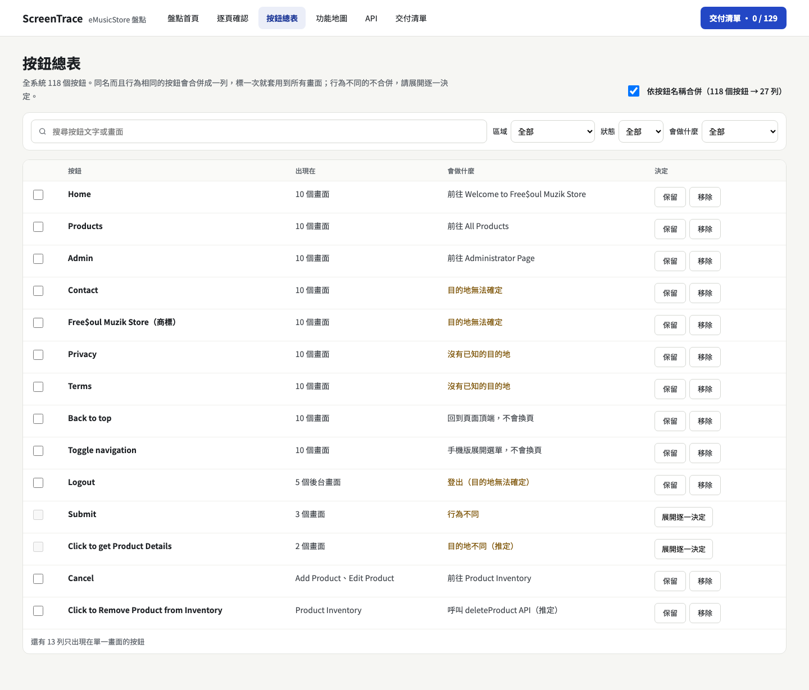 |  | 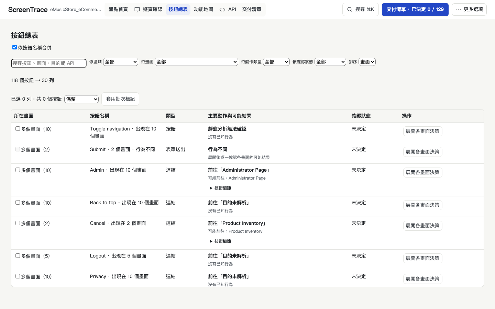 |
| 批次選取與行為不同展開 | 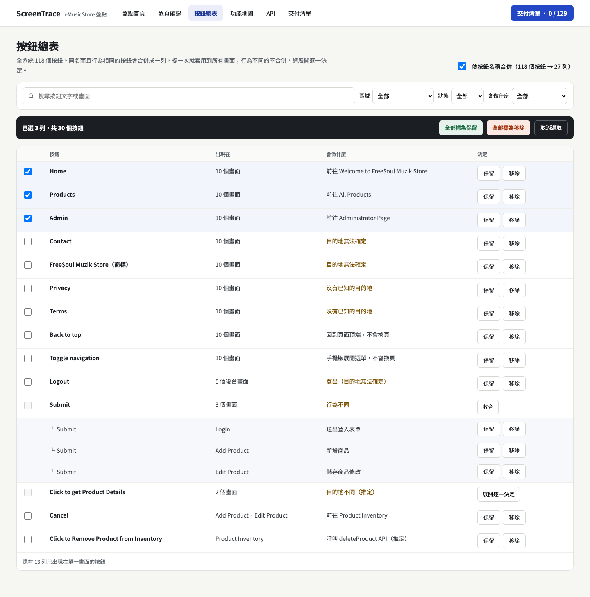 | 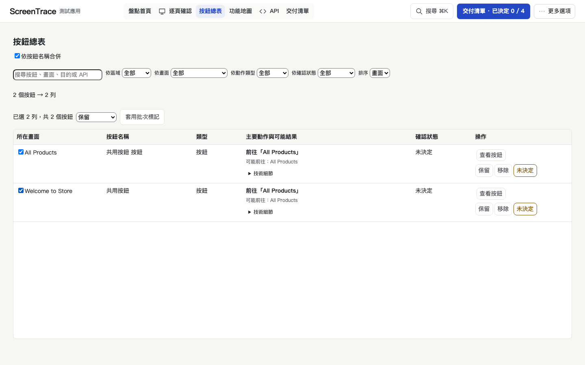 | 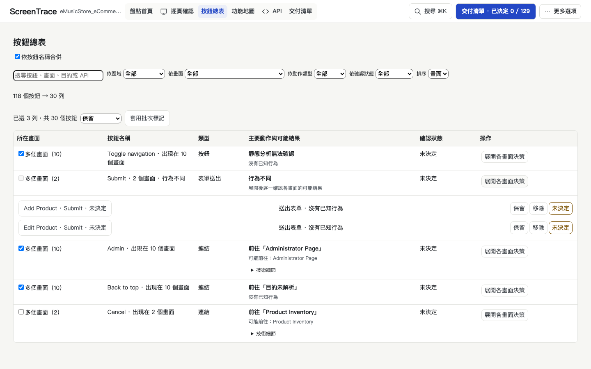 |

逐區對照：主導覽、標題與合併開關在三種實作狀態中順序一致；搜尋、區域／畫面／類型／狀態／排序篩選均可見；表格保留所在畫面、名稱、類型、主要動作與可能結果、狀態、操作欄。合成與 eMusicStore 的實際按鈕數字依圖資料計算，與設計稿示意的 27 列不同，差異原因如上。批次列在選取後出現，展開行為不同列顯示逐畫面成員，不允許勾選。測試通過：WP48 E2E 2／2，WP49 定向 E2E 3／3；完整驗證留待 WP50。

## WP49：功能地圖、API 頁與交付清單

WP49 結構測試先行提交為 `64cb405`、`4f5f043`、`e617dee`、`e7b17fe`、`c07734e`、`607e0ad`。最後一項新測試在修正前確認未聚焦地圖仍顯示空白右欄（`display: block`）；`e3231b1` 令地圖初始狀態隱藏右欄，聚焦畫面時才顯示。地圖 E2E 使用實際滑鼠移動與點擊關聯線，確認 tooltip、聚焦畫面、右側 API／按鈕資訊及「到逐頁確認」導引；泳道測試確認每個區域一欄，無入口與只有路由的畫面放在所屬欄內。

API 頁將後端 API 與前端請求描述分區；API 總數和狀態篩選依 `deriveApiUsage` 顯示，前端請求另列且不計入後端總數。未設定 context path 時呈現提示與設定指令；自動導向畫面網址顯示「系統自動導向」。交付清單取代匯出前對話框，顯示移除／保留／未決定、移除原因與影響、可展開的保留項目、未決定與衝突提示、容量提醒，並提供 Markdown 匯出／匯入入口。新增與更新的 E2E 確認下載統計一致、沒有舊對話框、名稱採 `humanizeName`。

1440×900 `file://` 實際畫面與設計稿並排如下；所有實作圖均為整頁報表截圖，不含頁面外說明條。合成資料取自自行撰寫 fixture；eMusicStore 使用唯讀報表。數字由圖資料計算，與設計稿示意不同時不調整資料以湊數。

| 區域 | 設計稿 | 合成 fixture | eMusicStore（唯讀） |
|---|---|---|---|
| 功能地圖 | 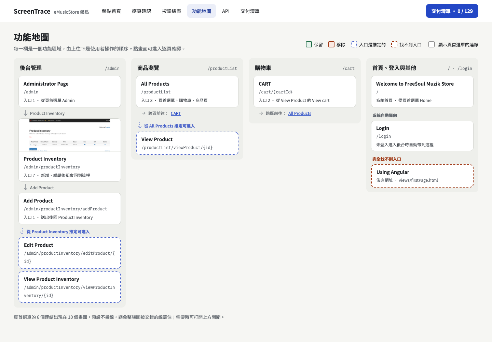 | 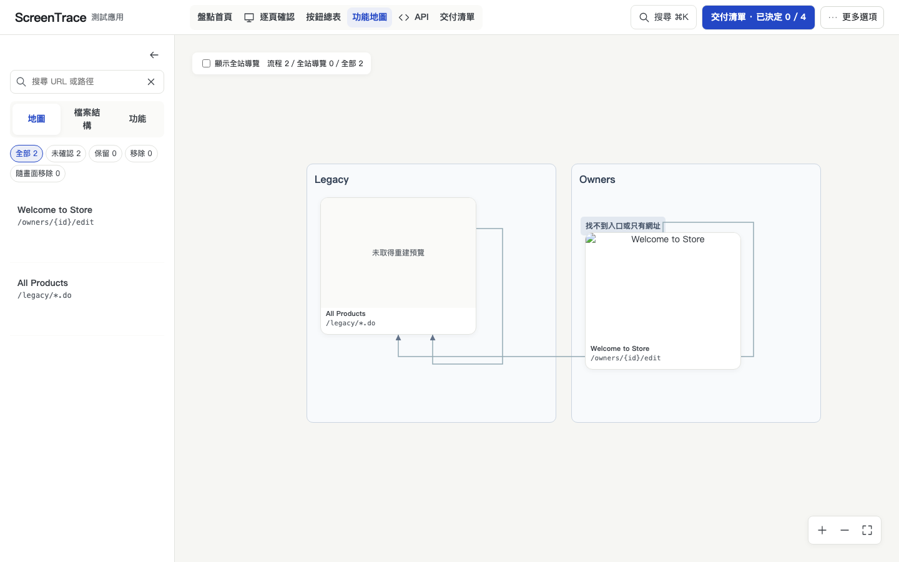 | 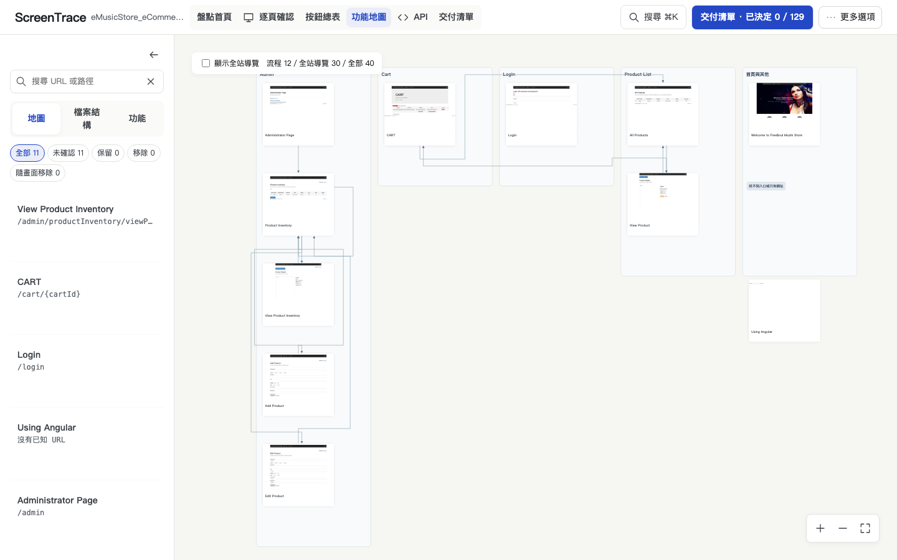 |
| 推定使用中的 API | 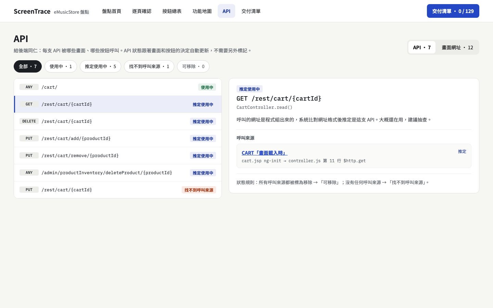 |  | 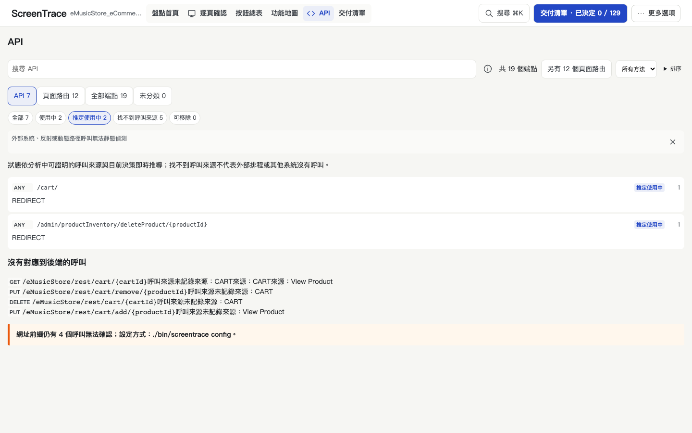 |
| 找不到呼叫來源的 API | 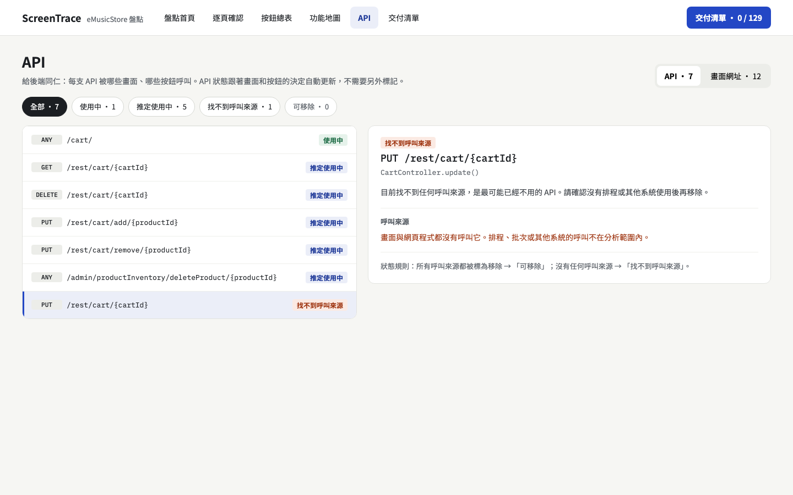 | 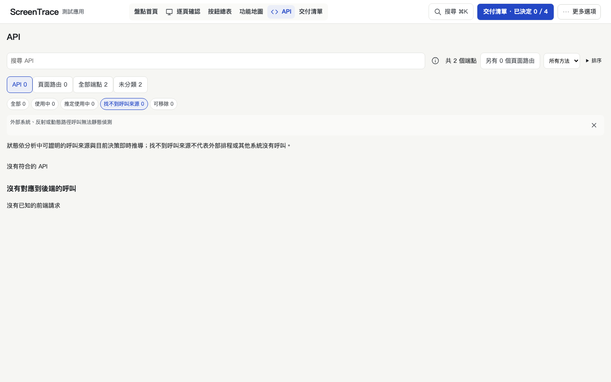 | 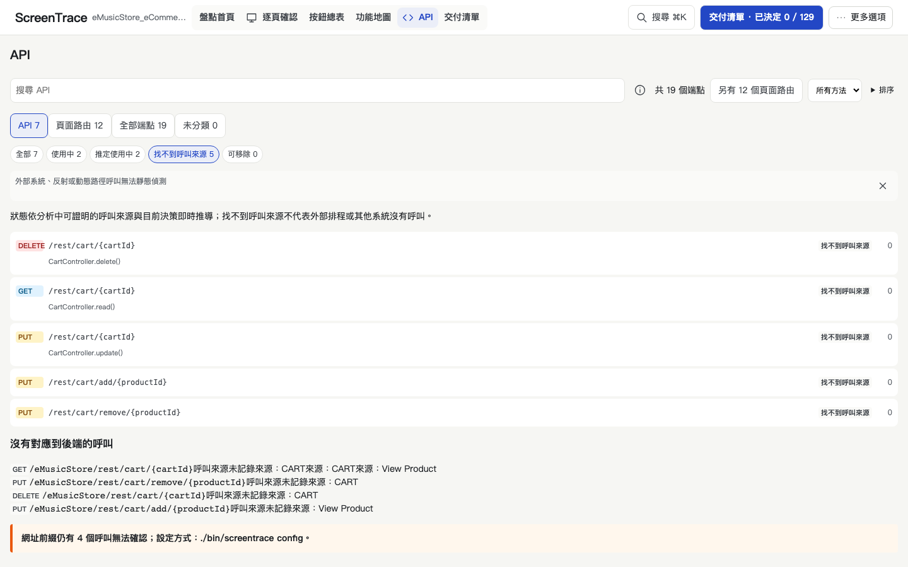 |
| 交付清單 | 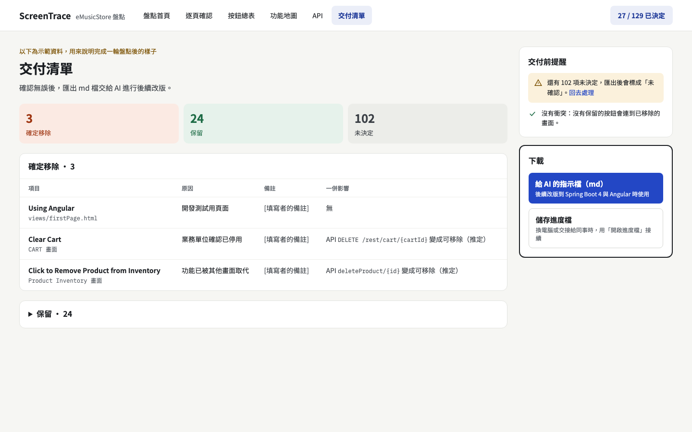 |  | 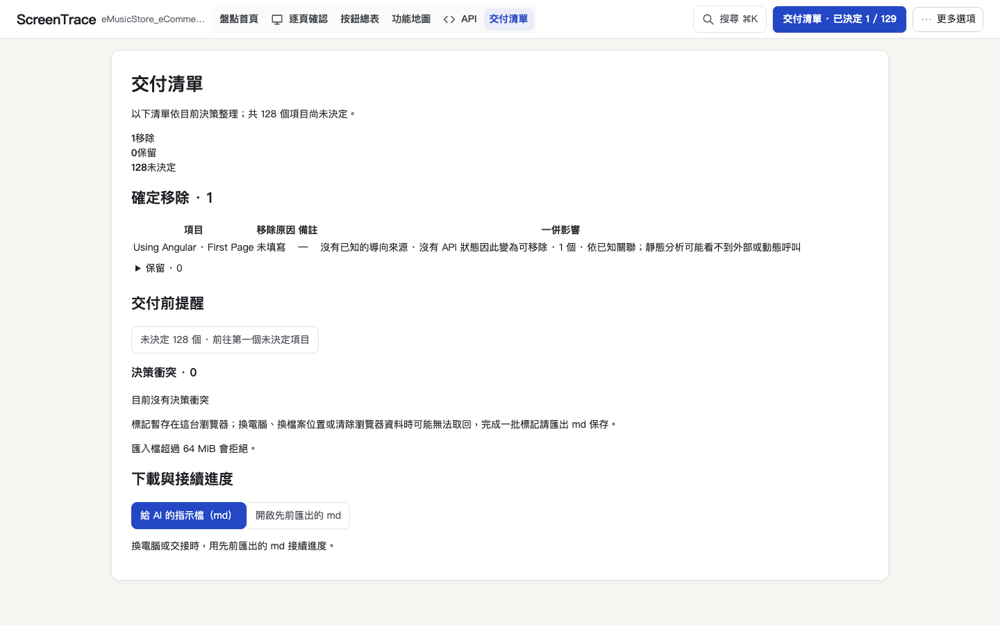 |

逐區對照：

| 區域 | 設計稿 | 實作 | 一致／差異與原因 |
|---|---|---|---|
| 地圖泳道 | 依功能區域分欄，保留跨欄關聯線、圖例與未連結子區 | 合成與 eMusicStore 均按區域分欄；沒有選取時右欄隱藏；未連結／僅路由卡片留在本區欄底 | 結構、卡片和線條符合；區域數及卡片位置由各圖資料決定，非設計稿示意值。 |
| 地圖互動 | hover 關聯線顯示來源、URL、縮圖；點擊聚焦 | 結構 E2E 以真實滑鼠 hover／click 驗證；聚焦後右欄可進逐頁確認 | 互動一致；初始空白右欄問題由測試先行修正。 |
| API 清單／詳情 | 推定狀態、方法與路徑、呼叫來源；未引用項目說明無來源 | API 篩選計數採共用狀態推導；後端 API 與前端 JS 請求分開，context path 提示只在診斷存在時出現 | 資料分類符合文字規格；列數、狀態和來源檔案依實際圖變動。 |
| 自動導向 | 畫面網址標示系統自動導向 | `AUTO_REDIRECT` 路由顯示「系統自動導向」 | 一致；不再顯示「找不到呼叫來源」。 |
| 交付統計與移除表 | 三態計數、原因、備註與影響 | 三態計數由 review state 計算；移除表列影響，未決定可跳回逐頁確認 | 結構一致；目前截圖的數字來自 fixture／唯讀 eMusicStore 決策狀態。 |
| 匯出／匯入 | 只提供 md 指示檔與先前 md 還原 | 直接下載 md、選檔匯入，提示交接與容量限制 | 一致；已移除匯出前檢查對話框與獨立進度檔格式。 |

WP49 視覺檔均為 1440×900。E2E 定向測試 3／3 通過（地圖 1、API／交付 2）；完整驗證留待 WP50。

## WP50：文件、截圖與最終驗證

指南依需求方盤點順序重寫：盤點首頁 → 逐頁確認 → 按鈕總表 → 功能地圖 → API 頁 → 交付清單；移除確認儀表板及匯出前檢查對話框的舊操作說明，增加推定入口、找不到呼叫來源、系統自動導向、跟著畫面詞彙。指南共有 21 張合成 fixture 截圖，沒有使用 eMusicStore 或 PetClinic 畫面。最終 `npm --prefix screentrace-viewer run guide-shots` 連續三次執行成功，逐張 SHA-256 清單完全相同（21／21）。初次三輪只在交付清單右上角的進度按鈕邊緣有 12 個像素出現細微 raster 差異；截圖準備條件現明確關閉選單，並將該按鈕的截圖邊框與圓角正規化後，三輪全部穩定。截圖含首頁、逐頁佇列、按鈕表、地圖、API、交付清單與其他操作說明。

WP50 的逐區視覺對照（1440×900 整頁，均為合成 fixture；無頁面外說明條）。指南截圖與對應畫面並列；指南沒有另外定義新元件，因此差異只記錄為操作說明截圖與設計稿的狀態／資料差異：

| 區域 | 設計稿 | 更新後指南截圖 | 一致／差異與原因 |
|---|---|---|---|
| 盤點首頁 | 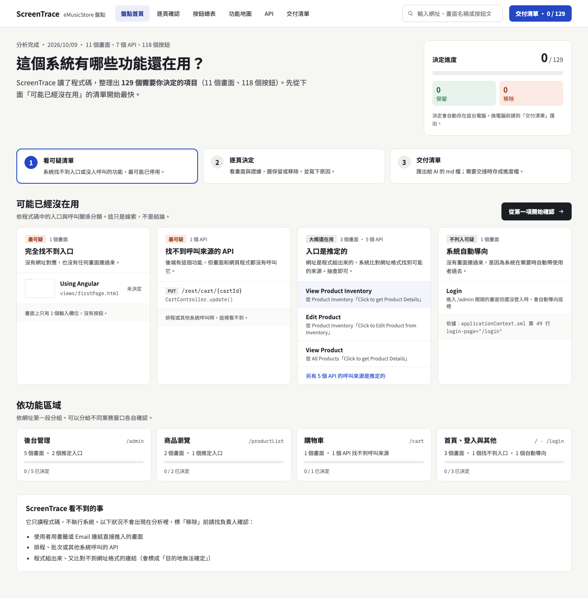 | 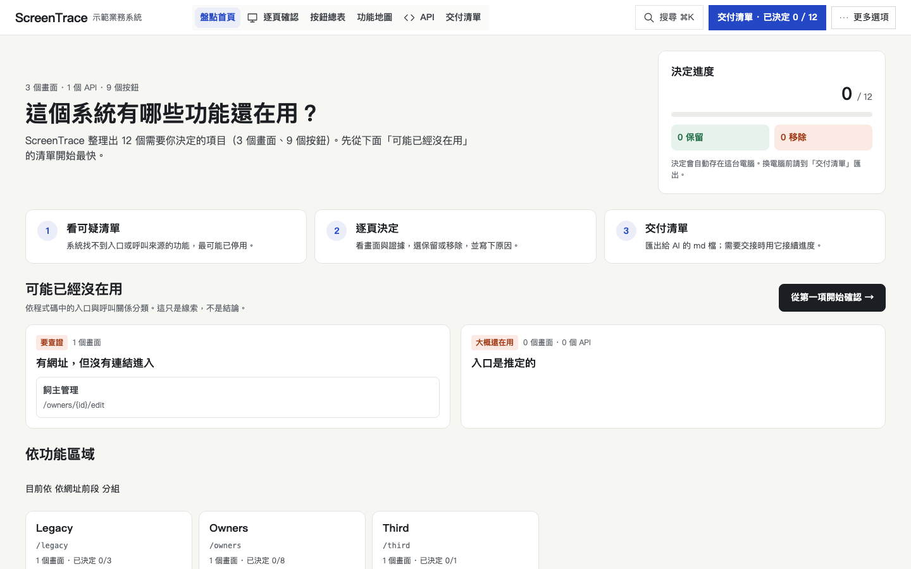 | 導覽順序與盤點首頁層級一致；數字、合成名稱與網址由 fixture 計算，故與 eMusicStore 示意不同。 |
| 逐頁確認 | 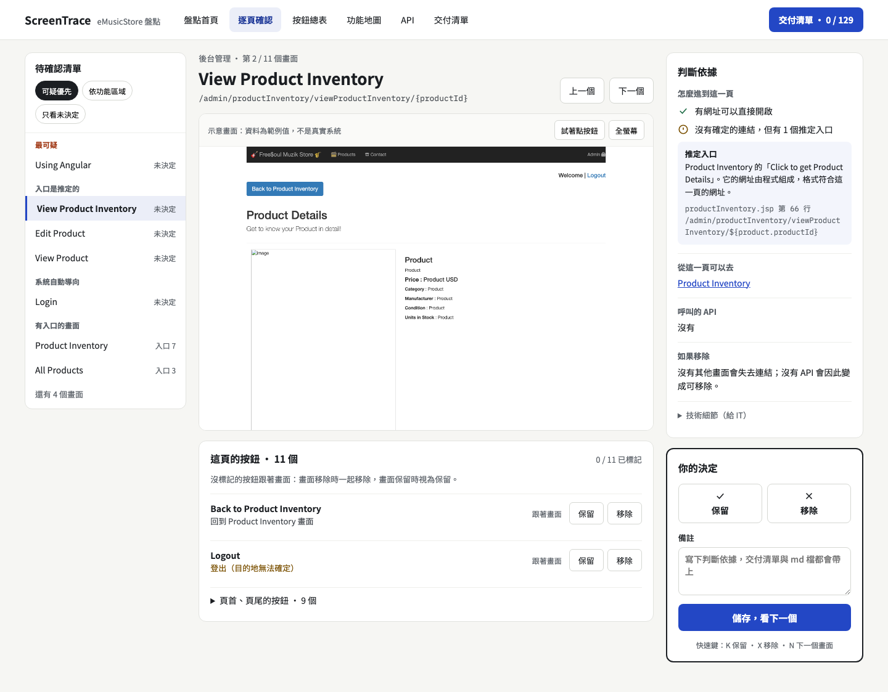 | 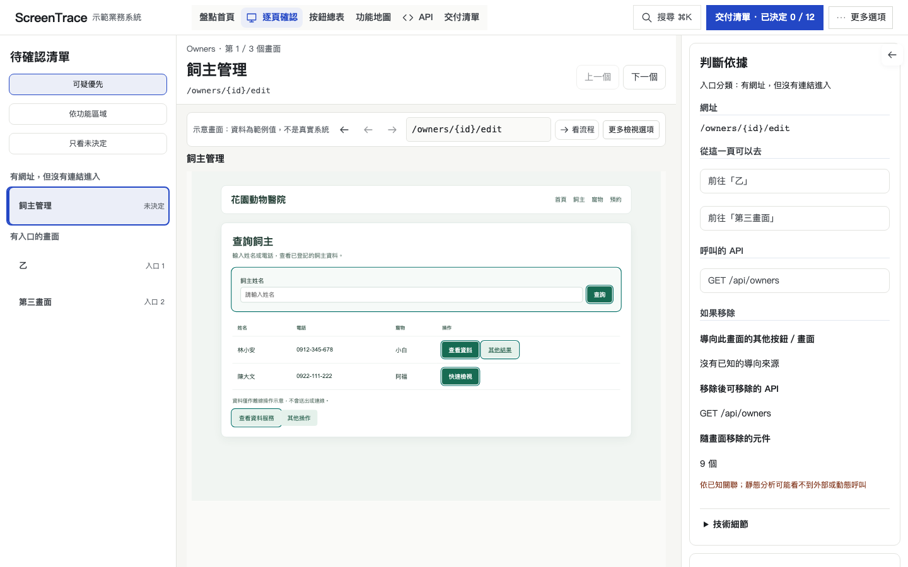 | 指南圖展示左側完整佇列及中、右欄；畫面資料與標記狀態是合成範例，檢視器仍可操作。 |
| 按鈕總表 |  |  | 表格資訊順序與交互用途一致；列數依範例圖計算，並示範按鈕名稱與行為分組。 |
| 功能地圖 |  |  | 地圖仍保留畫面卡片與關聯線；示意畫面與線數依合成圖而非設計稿數字。 |
| API 頁 |  | 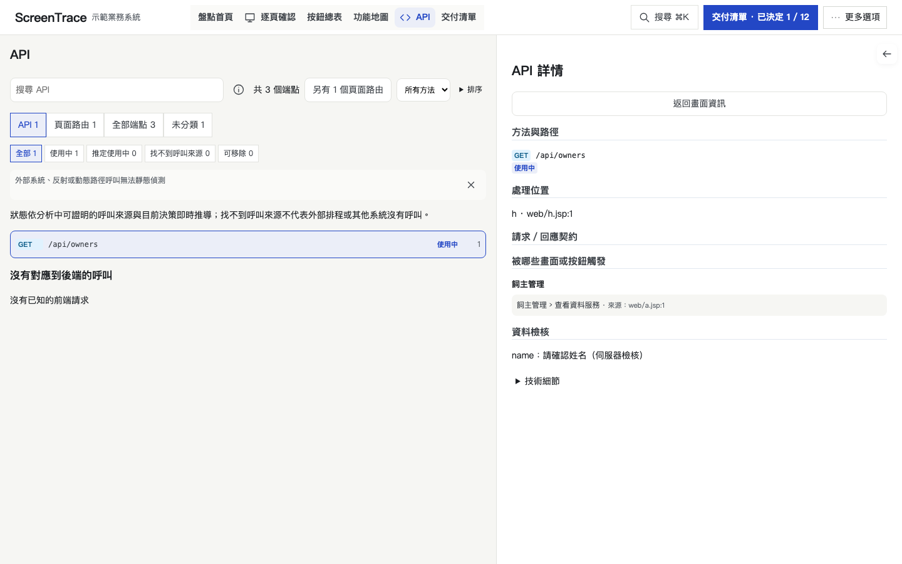 | API 方法、路徑、狀態與來源採分析資料；示範端點不同於設計稿資料。 |
| 交付清單 |  | 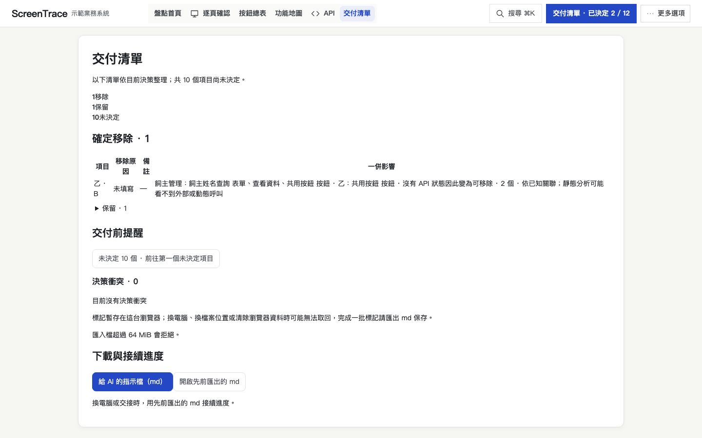 | 三態統計、移除原因與影響、提醒及 md 下載／匯入順序一致；依 R14-D4 不提供獨立進度檔。 |

本次以 Chromium `file://` 實際讀取三份先前由隔離 user.home 產生的唯讀報表，首頁與 API 分類核對如下。數字不是由截圖估算：

| 報表 | HTML 位元組 | 首頁畫面／API／按鈕 | 首頁推定入口畫面／API | API 類別總數 | context path 提醒 |
|---|---:|---|---|---:|---:|
| eMusicStore，無設定 | 3,857,105 | 11／7／118 | 3／1 | 7 | 4 個呼叫 |
| eMusicStore，設定 `/eMusicStore` | 3,876,672 | 11／7／118 | 3／5 | 7 | 無 |
| PetClinic | 3,738,260 | 10／2／68 | 0／0 | 2 | 無 |

§10.1 第 8 點要求的 eMusicStore 推定 API 數在設定 `/eMusicStore` 的首頁實測為 **5**，與預期相符。未設定時首頁為 1；兩種設定下首頁的 API 類別總數均為 7。`ANY /cart/` 是 `REDIRECT` 畫面路由，不屬 API 類別，因此不納入首頁推定 API 數；API 頁仍依 R-API 狀態顯示呼叫來源及 confidence，不改圖內 `INFERRED` 關係或升級 confidence。

設定 `/eMusicStore` 後，首頁列出的 5 個推定 API／端點是 `GET /rest/cart/{cartId}`、`PUT /rest/cart/add/{productId}`、`DELETE /rest/cart/{cartId}`、`PUT /rest/cart/remove/{productId}`，以及樣板連結推定的 `ANY /admin/productInventory/deleteProduct/{productId}`。`ANY /cart/` 來源為「View Product」的靜態網址，依入口取得方式分類不屬模板推定項；它是轉址畫面路由，也不計入「推定 API」卡片。這保留圖上的原始 confidence，沒有將 INFERRED 改成 CONFIRMED。

WP49 四組 1440×900 對照圖及逐區清單已列於上一節。地圖泳道測試 1／1、API 與交付清單測試 2／2 通過；地圖初始右欄的測試先失敗（空白欄 `display:block`），修正後未聚焦隱藏、點選畫面才顯示。WP50 指南契約測試 3／3、截圖穩定性 E2E 1／1、圖片路徑／完整性測試通過。舊版報表大小基準來自 WP47 實際輸出；WP49 只增補讀取頁面，沒有變更分析 payload 或資源封裝。

WP48–WP50 依 §2.4 更新的既有 UI 斷言逐處記錄於 ADR 0071；沒有修改資料正確性、安全、決策鍵、Markdown 往返或模擬規則斷言。WP50 最終完整驗證結果：

第一次完整 E2E 暴露逐頁確認用佇列取代左側導覽後，離開逐頁確認時沒有復原導覽內容；`show()` 現在只在佇列確實取代導覽時還原原控制項，避免每次畫面重繪都重建搜尋欄。另兩個測試定位到預設收合的詳細技術區或全站合併列，改為展開區域並鎖定可見列；決策、可達性、搜尋與安全斷言未放寬。修正後預設並行 E2E 158／158 通過。

| 驗證 | 實際結果 |
|---|---|
| `mvn -B verify` | 成功；73 份 Surefire 報告、305 案例，304 通過、1 跳過、0 失敗、0 錯誤 |
| `npm --prefix screentrace-viewer run build` | 成功 |
| `npm --prefix screentrace-viewer test` | 118／118 通過 |
| `npm --prefix screentrace-js test` | 44／44 通過 |
| `node --test screentrace-capture/*.test.mjs` | 43／43 通過 |
| `node --test screentrace-viewer/test/*.e2e.mjs`（預設並行） | 158／158 通過 |
| WP16 基準效能 E2E（預設並行） | 500 畫面、5,000 元件、3,000 關係；首次渲染 745.3 ms（門檻 834 ms），縮放中位數 36 ms |
| 指南截圖重跑 | 21 張；連續三輪逐張 SHA-256 完全相同（21／21） |

目標專案唯讀，沒有啟動目標程式或發出網路請求。WP50 完成後停止，等待需求方最終驗收。
